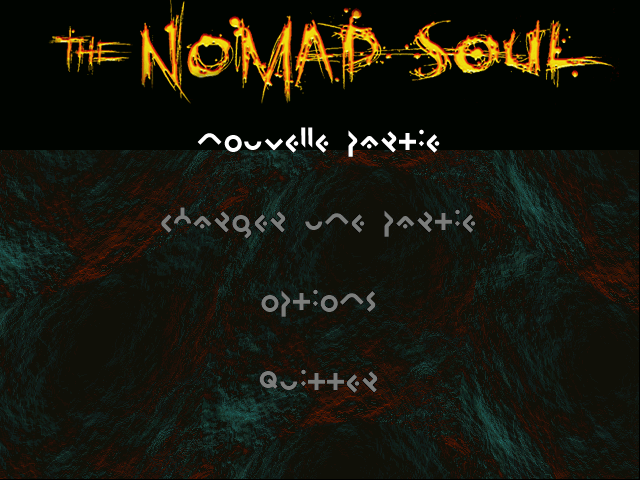
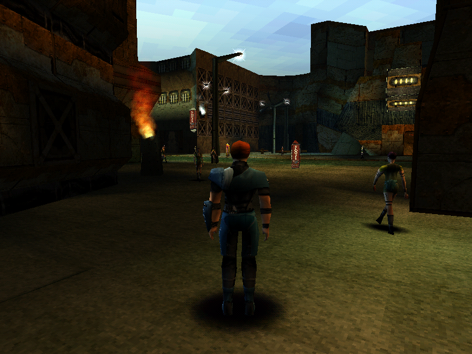

# 1. The original

← [Contents](README.md) · next: [Boot, and the frame](02-boot-and-frame.md)

---

## In short

*Omikron: The Nomad Soul* shipped in 1999 for Windows. It is three games
wearing one coat: you walk around a city and talk to people (adventure), you
fight people hand to hand (a beat-'em-up), and you shoot people (a first-person
shooter). Now and then you swim. The conceit is that you are a soul that moves
between bodies, so the game has to be able to hand you a different character
and keep going.

The engine that carries all that is a single executable of under a megabyte —
the game's `Runtime.exe` — plus the data files beside it. Almost nothing about
how the game behaves is compiled into that executable. What is compiled in is
a **machine**: a bytecode interpreter, a state-machine runner, a renderer, a
set of file readers. What the game *does* — which conversation starts when you
walk through a doorway, which camera watches it, which animation a character
plays when it turns around, which gunman patrols which corridor — is data,
sitting in the files beside it.

That split is why this project is possible at all. Read the machine once, and
the content reads itself.

  
   <em>The original engine's own framebuffer — the start menu, in the game's invented alphabet. Not a screenshot of a window: the framebuffer itself.</em>

**OMK** re-implements that machine in C++20 and reads your copy of the data. It
does not ship any game content and never will. It is developed on a Mac, and the
same game code also runs on a PS Vita, a Nintendo 3DS, PowerPC Macs as old as
Mac OS 9, and — as a prototype — a Meta Quest 2 headset.

## In detail

### What the executable is

The engine is the game's `Runtime.exe`, in the build that does not ask for the
CD. Two builds of it shipped — one that checks for the disc and one that does
not — and both are called `Runtime.exe`, so a tree holding both has to rename
one of them. **That renamed name is a local convention and means nothing about
the game**: every address in this repository refers to the no-CD build,
whatever the file is called on the disk it was read from (`CLAUDE.md`, its
opening paragraph). This manual names it `Runtime.exe` throughout for that
reason; `CLAUDE.md` and `docs/` carry the local name, `Runtime 2.exe`.

The tools do not hard-code either name: `omkpaths.exe_path()` takes the
largest candidate present, because the two builds are not close in size
(~985 KB against the launcher's ~280 KB, `CLAUDE.md`) and size survives a
rename in either direction where a name does not.

It is a Win32 binary against the 1999 Microsoft stack:

| subsystem | API | what the port does with it |
|---|---|---|
| video | Direct3D fixed function, fed a `D3DTLVERTEX` stream carrying a diffuse colour per vertex (`docs/ASSETS.md` §4c) | reimplemented behind a decision-level boundary (`docs/PORTING.md` A2): a software reference rasterizer into RGB565, and live backends for Vulkan, OpenGL ES, citro3d and fixed-function OpenGL 1.x (A1) |
| 2D / blitting | DirectDraw, `Blt` with colour keys (`docs/UI.md` §1) | ported exactly; a blit is a memory copy, so it is reproducible pixel for pixel |
| audio | DirectSound — a primary buffer at 22 050 Hz into which the system mixes (`docs/PORTING.md` A5) | the *decisions* are ported; there is no mixer in the engine to port |
| input | DirectInput, polled into a key-state array, plus a joystick read as `DIJOYSTATE` | ported, including the edge filter and `Input_Poll`'s own fix-ups (`verify.py: engine: input poll`) |
| video playback | DirectShow (`CoCreateInstance`) and MCI (`mciSendCommandA`) in the import table, for three MPEG-1 files — the image carries no MPEG decoder of its own (`docs/PORTING.md` A8) | replaced by a vendored decoder, or the host's own player; not a port of anything (chapter 2) |

The engine's whole frame is gated behind a Win32 idle loop — see chapter 2.

### The three modes, and why they share a spine

Adventure, fight and shoot are not three engines. They are three **input
context groups** over one actor runtime: 4 context groups × 14 actions × 3
devices, installed by whichever code takes over (`Fight_Begin` installs group
3, `Shoot_Enter` group 2, swimming group 1) — `docs/PRACTICE.md` §4, "the four
control schemes". Underneath, every character — player and NPC alike — is
driven by the same thing: a `.CTL` state machine read out of a data file,
matching the current input bitfield against the transitions its author wrote.

So "the player draws a gun", "the player dives" and "the player takes a step"
are the same kind of event: a transition in a graph that shipped on the disc.
What differs between the modes is who presses the buttons — the player, the
fight AI injecting button combinations into the opponent's own input queue, or
a gunman's brain — and which camera watches.

### The scale of the content

Each figure names the check or the section that asserts it:

| | |
|---|---|
| textures (`.3DT`) | 2 534, all decoding exactly (`textures`; `docs/PORTING.md` B1, tier 1) |
| models and sets (`.3DO`) | 635 models, 16 188 meshes, 666 cameras (`engine: 3DO`) |
| lights inside those models | 4 179 records across 216 models (`light record`; `docs/FILE_FORMATS.md` §5b) |
| animation quaternions (`.ani`) | 243 362, every one a unit quaternion (`.ani quaternions`) |
| morph/voice files (`.3DM`) | 777, sample-identical audio (`.3DM files`, `engine: morph+ADPCM`) |
| scene scripts (`.SCX`) | 220 (`.SCX scenes`) |
| world script slots | 5 785, all decoding (`world scripts`) |
| trigger zones | 4 558, none malformed (`zone records`) |
| conversations | 321, of which 105 no script launches (`unlaunched dialogs`; below) |
| VM opcodes | 153, of which 133 are named (`docs/SCRIPT_VM.md`, "Naming the opcodes"; chapter 4) |
| interface screens | 37, over a widget tree of 61 panels, 179 lists and 744 items (counted in `tables/ui_widgets.json` at this snapshot) |

### What "reimplementation" means here

Not emulation, and not a rewrite from a design document. The unit of work is:
read a function in the disassembly, establish what it does, write a check the
shipped data could fail, then write the C++ that makes the same decision. The
standard for when that counts as done is `docs/PORTING.md`, and chapter 12 of
this manual is its summary. The checks live in `tools/verify.py`: **651 of
them** in `verify.py --list` at this snapshot, 397 of them behind `--slow`. The
last full sweep, on 2026-10-30, ran 650 and recorded 3 failures, each then
attributed or mended (`todo/sweep-log.md`).

The one thing that cannot be read out of the data files is the set of tables
**compiled into the executable** — the VM opcode table and its announce map,
the widget tree and the interface tables, the key bindings, the camera
presets, the special moves, the ADPCM coefficients, the fight AI's built-in
moves, the shoot AI and the shoot weapons, the city maps. Those are lifted to
JSON in `tables/` (12 files), which is why a replica needs both your data
directory *and* this repository's `tables/`.

### Where the replica has got to

From a cold start it steps the three intro movies, shows the splash, draws the
start menu and takes an answer, plays the Kay'l intro conversation with its
dialogue cameras and voice-over, flies the Impasse's camera editings, and hands
over the player: adventure mode with a follow camera, a walkable floor that
stops at walls and rails, the jump and the fall, swimming, and area
transitions that keep two sets resident and play the doors between them
(`README.md`). Its announcement stream matches a capture of the original
**42 of 42, in order**, from a cold start (`engine: boot`; chapter 2).

From there, each of these runs through the game's own data (`README.md`):

* the **sneak** — Kay'l's device — with its inventory and verbs, the memo
  journal, the identity page and the city map;
* the **slider**: called, boarded through its door, flown;
* **shops** and the **MULTIPLAN** storage kiosk; the security centre's **lift**
  and **terminals**;
* **saving and loading** through the game's own panels; the **pause screen**;
  the **options menu**;
* **melee**, with the game's own adaptive fight AI;
* **shoot mode** — first person, with gunmen who patrol and fight over the
  level's navigation grid — including the two **boss fights**, Astaroth and
  Gandhar, each with its own compiled brain;
* the **clock**: the fog colour and, in nineteen areas, the ambient light follow
  the time of day; and the city's **weather** turns to rain and snow on the
  original's own cycle.

The city's crowd and its road traffic walk and drive their circuit around you,
lit by the lights baked into the set and casting the engine's own blob
shadows. How many walkers there are is the engine's own rule, not the port's:
`Slider_Init`'s spawner places one pedestrian every `39 × (5 − density) × h[3]`
units along each lane of the shipped circuit (`docs/STREET_LIFE.md`;
`docs/PRACTICE.md` §4). So the port populates the street the original
populated, on the same models — not a denser one.

What the original never did is there too and **off unless asked for** — the
enhancements (anti-aliasing, smoothed 60 fps and others), and beyond them a
*remaster* tier that overrides authored art and compiles only on the desktop
and the Quest (`README.md`; `docs/PORTING.md` A1). Chapter 11 has both.

Much of this has been confirmed by a person playing it; what has not is listed
in `todo/play-test.md`, and nothing is claimed as confirmed beyond what a
reader has confirmed.

The coverage audit in `engine/README.md` §Coverage counts, against the 41
content rows of the solved-formats table: **31 fully ported, 7 partly, 0 lifted
but unconsumed, 0 unported**, and 3 that are this project's own instruments.
That table has been wrong twice, so read it rather than this paragraph.

### The other machines

The game code asks which machine it is on in one place, `engine/src/platform/`;
everything else lives in a backend, and the viewer reaches its host only
through `omk::Frontend` (`README.md`, "Platforms"; `docs/PORTING.md` A1). Each
machine has a handoff file with its state, and the figures below are that
file's, measured on that machine — they are not comparable with one another:

| machine | where it stands (`README.md`, "Other machines") |
|---|---|
| **macOS, Apple Silicon** | the development host: the software reference, Vulkan (through MoltenVK) and GLES, on SDL2 or SDL3. Windows and Linux desktops have never been tried |
| **PS Vita** (GLES2 through vitaGL) | on a real console from the films to the city; a console log of 2026-10-05 put Anekbah's street at ~27–31 ms a frame, inside 30 fps (`todo/handoff-vita-port.md` §3b4c) |
| **Nintendo 3DS** (citro3d) | on a New 3DS into the city; in the Azahar emulator the boot reproduces the original's trace 42 of 42 (`todo/handoff-3ds-port.md`) |
| **Classic Mac** (Carbon, fixed-function OpenGL 1.x) | an iBook G3 runs Anekbah at ~100 ms a frame; an iMac G3 under Mac OS 9 at ~17 frames a second with a 50 m clip, 9–12 at 100 m. Big-endian reads are handled by rule (`docs/PORTING.md` A9; `todo/handoff-classic-mac.md`) |
| **Meta Quest 2** (OpenXR) | immersive at 72 fps; a prototype (`todo/handoff-quest-port.md`) |

  
   <em>The port, in adventure mode: Anekbah's main street with its procedural crowd, its ambient fire and neon, the set's own lights and the characters' blob shadows. The command that produced this frame is in <code>manual/images/README.md</code>.</em>

## Where it lives

| | |
|---|---|
| the original | the game's `Runtime.exe`, the no-CD build (yours; never in this repo) |
| the disassembly | `Runtime.exe.asm` / `Runtime.exe.c` — optional, not distributed, relocatable via `$OMK_ASM` / `$OMK_DECOMP` (`CLAUDE.md` §2) |
| the hand-cleaned reading | `readable/src/*.c` — 33 modules, every function carrying a status banner; generated on each machine and not committed (`.gitignore`); `readable/INDEX.md` is the committed index |
| the findings | `docs/` — 11 documents |
| the port | `engine/` — C++20, no required dependencies. `engine/src/` is 10 directories and ~77 400 lines; with the eleven backend directories and the 229 probe tools in `engine/tools/`, ~168 800 (counted with `wc -l` on 2026-11-02 at `cb957fe`, vendored code excluded) |
| the other machines | `todo/handoff-vita-port.md`, `handoff-3ds-port.md`, `handoff-classic-mac.md`, `handoff-quest-port.md` |
| the lifted tables | `tables/*.json` — 12 files, each self-checking |
| the readers and viewers | `tools/` — 68 Python files outside the scratch `_*.py`, stdlib only; five web viewers |
| the checks | `tools/verify.py` — 651 checks; `--list` is the index |

## What is not settled

* **105 of the game's 321 conversations are launched by no script**, and the
  reading is that they are **cut content** rather than evidence of a launcher
  nobody has found: the unlaunched ones carry their facial-animation `.3DM`
  in 14% of cases against 68% for the launched ones, while their text is as
  complete (`verify.py: unlaunched dialogs`; `docs/PRACTICE.md` §6). It is a
  correlation over the shipped corpus, not a proof. Chapter 13 has the
  measurement.
* **Two modes run whose behaviour no instrument here can check against the
  original.** Melee and the actor runtime under it are *data-constrained*
  (tier 5): the golden-trace rig sees only what a script handler announces,
  and `fight.begin` announces nothing, so a fight's outcome has no oracle
  (`engine/README.md`, the melee entry). Shoot mode is in the same position
  (chapter 6).
* **The other machines sit outside the coverage audit**, and their figures
  are each one log on one machine. The Quest build is a prototype; the
  classic Mac is being made faster step by step; the Vita's films are not
  confirmed at speed on a console (chapter 2).
* **The joystick's coverage row lags the code.** `engine/README.md` §Coverage
  still says the joystick axes are "carried but nothing steers with them
  yet", while `engine: input poll` asserts the axes reaching slots 0..3 by
  `Input_Poll`'s own rule. The audit is the authority and has not been
  brought up to date; until it is, the two disagree.
* **Windows and Linux** desktops have never been built (`README.md`,
  "Platforms"). They are unexplored, not supported.
* Whole subsystems of the original are **read but not exercised**, because the
  port has not reached the part of the game that uses them.
