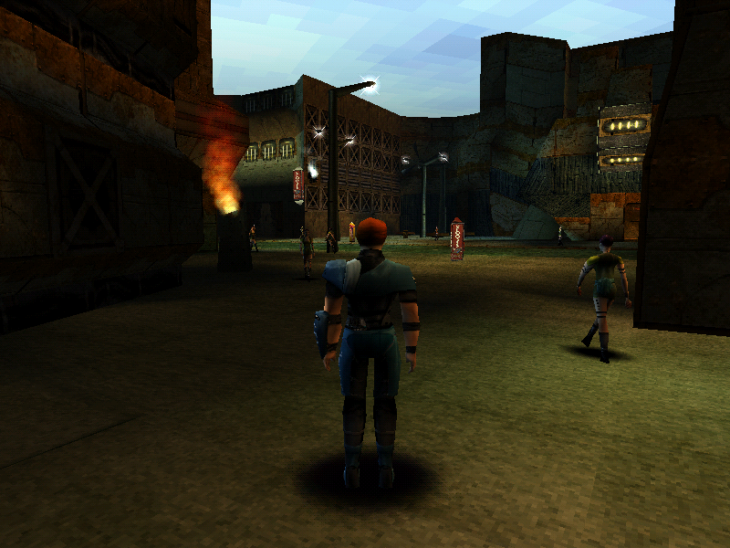

# 6. Actors

← [Contents](README.md) · prev: [The world](05-the-world.md) · next: [Conversations and cutscenes](07-conversations-and-cutscenes.md)

---

## In short

The character you steer runs on a **state graph that shipped on the disc**. So
does every character that fights you.

A `.CTL` file is a list of states, each naming an animation, and a list of
transitions between them, each naming the buttons that take it. Press forward
and the graph moves from standing to walking, because an author drew that edge.
Run long enough and then stop, and the graph sends you into a breathless pause,
for the same reason. Press the action button next to an object and the graph
walks its chain of states. Press it beside a parked slider and a different arm
of the same handler opens the door and seats you.

So "the player draws a gun", "the player dives" and "the player takes a step"
are the same kind of event, and fight mode and shoot mode are not separate
engines. They are different **control schemes** feeding the same graph, with
different things pressing the buttons. In a fight, the opponent's AI presses
combinations into his own input queue exactly as your keyboard presses into
yours. In a shoot phase, each gunman has a small brain that walks the level's
navigation grid, and the two bosses have brains of their own.

Most other characters have **no graph at all**. A placed character holds his
pose until a scene program, a fight or a shoot phase takes his body.

Around all this sits a walker that decides whether a step is possible: how
steep is too steep, how high a ledge you can climb, what happens when you jump
or fall, and what changes when the floor is water. In the cities there is also a
crowd: pedestrians and vehicles following a circuit authored as lanes and
routes, as dense as the options menu asks, and spawned by the engine's own rule.

Carry one thing through the whole chapter: **none of this has an oracle.** The
trace rig that checks the port against the original (chapter 12) cannot see the
actor runtime at all. Everything here is judged against the data, against the
original's code as read, and against what a person sees when they play it. It
is never judged against the original's own output.

## In detail

### The `.CTL` channel

There are seven files, and all seven parse to the byte. The walk lands exactly
on the file size, there are 398 clips, and **every one of 2 044 graph edges
resolves**. The loader refuses to start otherwise, which is what makes that a
test the data could fail (`docs/PRACTICE.md` §4; `verify.py: ctl groups`,
`ctl transitions`). A `.CTL` is a saved memory image whose pointers are stale
authoring addresses. The loader never follows them: it walks the file in a fixed
order and overwrites each one (`docs/ASSETS.md` §7, ".CTL").

A state's entry carries flags, and every flag-gated block now has a traced
consumer (`docs/ASSETS.md` §7; `verify.py: ctl flag blocks`):

| block | what it is |
|---|---|
| the combat block (`0x2000000`) | damage, the hit window, the reaction (keyed by the low 16 bits of an entry id) and knockback. Consumed by `Fight_ResolveHit` and present only in the three combat files. All 232 reaction references resolve (`ctl combat block`) |
| turn and root shift (`0x140`, `0x280`) | each in two modes: spread over a frame window (`0x40` / `0x80`), or applied whole when the state is left (`0x100` / `0x200`). `Cef_ApplyTurn` and `Cef_ApplyRootShift` |
| the move name (`0x10`) | resolves into the executable's own 66-row `tab_special_move[]` of engine callbacks. All 54 distinct names at 209 shipped sites resolve (`ctl special moves`) |
| `0x200000`, with `0x10` | the move is queued **every tick**, not only on entry. 95 entries carry the pair, and the free look exists only because of it |
| bit `0x20` | the group's default entry, exactly one in each of the 202 groups |
| `0x8002` / bit 2 | no clip of its own; bit 2 redirects through the entry's GoTo chain |

**The window gates were read on 2026-10-11.** The whole-on-transition turn and
shift are skipped when the channel's no-playback flag `0x200` is set. The
per-tick window versions sit under channel bit **2**, and nothing in the shipped
engine sets that bit, so they always run. The port had them on the wrong flag.
No run can see the difference, because under `0x200` the channel's frame does
not advance and the window's share was zero either way. No check was added for
that reason (`docs/ASSETS.md` §7, the `0x280` row; `todo/scene-gameplay-audit.md`
row 23).

The `+28` sub-records are each state's **effect records**: bone-attached sprites
and frame-triggered sounds, footsteps among them. All 590 decode (`ctl
effects`). A sound id in one of them is an *id*, looked up in the resident
scene, not an index. So a state's footstep is silent in a scene that does not
carry that id, and that is the engine's own behaviour (`docs/ASSETS.md` §7).

Transitions are matched against the current input bitfield, with cancel
windows, priorities and group-global edges. How a press gets *into* the queue
has been read to the instruction. A lone idle word is dropped, so the first
press of a bank acts on the tick it arrives. One flag cuts the queue to a single
word. A push dedupes against the back of the queue. And an entry's GoTo can be
**rewritten at run time** into a dynamic return edge, which is the only way two
`Sham.CTL` entries can be reached at all (`docs/ASSETS.md` §7, the walker
section).

**On a clip change, the new clip's first frame of root motion is applied on the
same tick.** `Actor_PlayClip` zeroes the previous frame before the channel
samples, so the interval is (0, start]. The new clip's key 1 is therefore
applied on the transition tick. Key 1 is almost always a pure vertical offset:
47 of `H1AVNT`'s 81 root tracks carry more than 0.5 of it, and only 7 clips in
all seven files have any x or z in it, none over 0.5. So the rule hardly changes
where an actor *stands*, but it changes where he is *drawn* at every clip
change (`docs/ASSETS.md` §7, "where the forward motion comes from"; ported
2026-10-06).

The port runs all 202 groups of the seven banks. It lands in 34 056 states and
re-derives all **12 063 edges** from the files (`docs/ASSETS.md` §7,
`ACTOR_STATE`; `verify.py: engine: actor states`). Its standard is
**data-constrained, not engine-verified**. The reason is structural, not a gap
in effort: see *What is not settled*.

Some special moves are **the most consequential code in the actor runtime**,
because they are where a data file hands control to the engine:

* `MDACTION` is the action button: the take, the slider door, a talk, and in
  shoot mode the zone press.
* `MDJUMP0A..03` are the jump.
* `MDDIVEND`, `MDSW2SD`, `RSTAVNT` and `RSTNAGE` move a swimmer between states.
  None of these four is in the decompilation. Nothing calls them directly;
  they are dwords in a table. Their addresses were fixed by aligning each block
  onto the next table row (`docs/ASSETS.md` §7).
* **`MDRUN` / `MDWALK` and `MDSTOPR` / `MDSTOPW` are the out-of-breath stop**,
  read from the raw image on 2026-10-29. The two gait moves store the channel's
  loop count. The two stop moves enter H1Avnt's group **164** (`H_RUN-SD`,
  `H_BREATH`) when the run has looped more than 30 times, or group **166** when
  the run has looped more than 30 times and the walk fewer than 3. That is about
  19 seconds of running. A reader had remembered it from the original: *"it
  stops and plays an animation of the character breathing loudly"*
  (`docs/ASSETS.md` §7, the `0x10` row; `todo/scene-gameplay-audit.md` row 18;
  `verify.py: engine: out of breath`; not yet played).

### `ACTOR_STATE`

There are eighteen states, 0..17, mapped **and run** (`docs/ASSETS.md` §7, the
`ACTOR_STATE` table). Several repay the reading:

* **11 is entering the water.** It was read as "the ladder", from the
  decompiler's own comment, until 2026-09-17. The floor that triggers it is
  the canal's bed. **14 is underwater.** Special moves write both.
* **7 and 8 are the mount and the ride of one slider**, and the dismount move
  refuses to leave from anything but 8: "bad mode getting out of the slider !"
  is its own error string. State 7 has **no case at all** in the per-frame actor
  tick, because the slider's own tick drives the actor there.
* **2 is melee**, and `Fight_Engage` is its only writer. It writes through an
  alias that a search for the obvious store misses. A state that the dispatch
  names but that has no writer is a sign that the *enumeration* is incomplete,
  not the data.
* **A placed NPC has no `.CTL` machine at all.** Every caller of the bank
  loader is the player's, or the melee opponent's through `Fight_Engage`. A
  spawned character therefore sits in state 0 until a scene program, the shoot
  AI or a fight owns his body (`docs/STREET_LIFE.md` §0). What he looks like
  meanwhile was read on 2026-10-06. Nothing applies a clip to him, so he holds
  his last pose, or his model's **rest pose** if nothing has ever posed him.
  The port used to give every banked body the player's idle
  (`todo/drift-audit.md` M2; `verify.py: engine: undriven rest pose`).
* **A body-animation step finds its body by name.** Neither scene function
  takes an actor. Both resolve the node from a name in the object's own string
  table, and the opcode that started the object pins only one slot. That is how
  Gandhar's snake rises out of the lava from an object nobody started on him
  (`docs/FILE_FORMATS.md` §5c, "WHICH BODY a body-animation step moves";
  `todo/drift-audit.md` M2b; `verify.py: engine: gandhar play`).
* **Every shown character is a body.** `Actor_Attach` registers every attached
  actor in the spatial index, and the player is pushed off any of them. The port
  had registered only the street walkers and the gunmen, and a reader walked
  through the Sham (`todo/scene-gameplay-audit.md` row 19; `verify.py: engine:
  actor body`).
* **A soul transfer puts you in the new body where it stands.**
  `player.become` reads the *new* body's position and facing. The port had kept
  the old one, which put the Sham 29 units off after a mount
  (`todo/scene-gameplay-audit.md` row 3; `verify.py: engine: become place`).

### The walker

A step up is refused when the face is steeper than **30°**, when the rise is
higher than **30 cm** (`dword_910340`, 11.81 world units), or when the mesh
carries the "you may not step onto this" bit `0x20000000`. That is three arms,
not two (`docs/ASSETS.md` §7). The game's own staircases, measured, have risers
of 6.17 to 8.30 units, so no staircase can be refused for its height
(`verify.py: engine: stairs`).

**A step down is never silent in adventure mode.** The code has a silent-drop
branch for drops under **20 cm**, but it is gated by `sub_47CF00`, read from the
bytes on 2026-10-11, which returns 1 whenever there is no shooter. So outside
shoot mode, every drop, including a single stair, is banded as a short fall and
gravity takes him down. The short band asks for no bank group, so the walk clip
plays on and **a short fall keeps walking**. Only a fall of 1.5 m or more
switches to the held falling pose. The port had absorbed every drop under 20 cm
and glued the player's feet to every tread. Walking down the seven straight
flights the game ships, he now floats at most 11.5 units (29 cm) above the tread
below and stalls 0 frames, where the old vertical fall stalled 4 to 63 frames
per flight (`docs/ASSETS.md` §7, "A DROP UNDER 20 cm IS SILENT";
`todo/scene-gameplay-audit.md` row 22; `verify.py: engine: stairs down`). In
shoot mode the silent drop runs, except during the shoot jump.

The world unit is an **inch**; the engine tells the audio listener so
(`docs/ASSETS.md` §3c). The studio still authored in metres, which is why the
constants are round numbers in one system and not in the other.

**The forward motion comes from the clip.** `Anim_RootDelta` sums the root's
position keys over the frames advanced and turns the sum by the actor's facing
matrix. The walker then undoes that delta and hands it to the collide-and-slide:
*the clip proposes and the collision disposes*. Turning comes from the `.CTL`
too. A held left or right is a turn edge of 5° a frame (`docs/ASSETS.md` §7).

**The ground answers every frame, standing still included.**
`Actor_ApplyMotion` probes the floor whatever the move was, a zero move
included. That is what carries a player on a lift (chapter 5;
`verify.py: engine: lift ride`). When the probe finds no floor, the body goes
back to its last safe position, so nobody walks into the void
(`docs/ASSETS.md` §7).

**The narrow phase is partly a reconstruction.** The engine's own sweep
(`Sweep_ActorMove` over the 930-line `Sweep_PolygonKernel`) is deliberately not
transcribed. The port's version uses three passes and the model's own collision
spheres, stops one unit short of the contact and slides the remainder along the
wall. It stops the player 13.0 units in front of a wall (`verify.py: engine:
narrow phase`). Its parts have different standing:

* **Only the body's bottom rises by the step.** This is now read, not chosen.
  `Actor_Move` turns the sphere list into one capsule and lowers its bottom by
  the 30 cm step, leaving its top alone. The port had raised the whole stack by
  the step, its own labelled guess. In Kay'l's lift the top sphere then met the
  cabin's lintel 82 units up, and a reader had to jump to get out. The port now
  lifts only the spheres inside the step window (`docs/RECONSTRUCTION.md`,
  2026-10-01; `verify.py: engine: lift lintel`).
* **The sweep meets edges and corners, counted only from outside.** This is
  still a labelled reconstruction. The first stand-in tested a triangle's
  interior only. On the security centre's handrails, 8-unit bars at waist
  height, a player ran through the rail and down the shaft: *"not possible in
  the original game"*. A first fix also counted an edge the sphere already
  overlapped, and it threw a player round a bar stool (`docs/ASSETS.md` §7,
  "The body sweep meets EDGES and CORNERS"; `verify.py: engine: security rail`).
* **The edges of the set and steep ramps are the port's own bounds.** A body
  that steps off the set's edge in the air gets its frame's horizontal move put
  back, which follows the original's revert. A falling body lands on a face no
  steeper than 60° and slides down it, instead of falling through. Both bounds
  are the port's, labelled in `engine/src/actor/walk.cpp`, and they were
  confirmed in play on 2026-10-21 (`verify.py: engine: walk edges`).

**The jump.** `Actor_MoveBy` applies X and Z only, so the vertical belongs to the
walker alone. A walk that seemed to float turned out to be the port mixing two
origins, not anything in the clips (`todo/player-vertical.md` §4). The jump is
`MDJUMP0A` and `MDJUMP01`: 2.5 m forward over a number of frames the entry
carries, with a vertical impulse that brings him back down at the end. It
measures 14 frames and 22.9 cm of lift, a flat leap rather than a hop
(`todo/player-vertical.md` §5; `verify.py: engine: player jump`).

**The fall.** Stepping off a ledge is banded by the clearance below: 1.5, 3 and
5 m select the falling group and a camera request. The landing is banded by the
distance fallen: back to walking, a stumble, the stumble plus **message 10**, or
lying flat with **message 11** and an overhead camera. The "fall states" a first
reading found were camera requests. A vehicle still moving fast when it touches
a player on the road raises **message 17**, and Anekbah's handler knocks him
flat. Every script that costs health outside a fight or a shoot phase floors it
at 5, so **nothing in adventure mode kills the player**. There is no adventure
death to port (`docs/ASSETS.md` §7, "The fall reaction"; `todo/falls.md`;
`verify.py: engine: fall reaction`, `engine: run over`). Since 2026-10-29 a fall
or a run-over also flashes the health bar, through op 93's player arm
(`engine/README.md` §Coverage, "OUT OF BREATH and THE HEALTH FLASH";
`verify.py: engine: hud flash`; not yet played).

**The free look.** Key L (*Vue première personne*) is `MDHEAD00` / `MDHEAD01`.
It turns the head within ±40° of pitch and ±70° of yaw, on camera preset 3,
which is framed on the head. It needed the channel's third move site, the
every-tick queue above. Without that, the look lasted 1 frame in 53
(`todo/scene-gameplay-audit.md` row 11; `verify.py: engine: free look`; not
played).

### The water

`Actor_ApplyMotion` hands states 11..14 to `sub_4A8F30` instead of applying
gravity. In Jaunpur, where this was settled from the loader, mesh flag
`0x8000000` marks the canal's bed and banks and `0x20000000` marks the surface.
The surface holds a swimmer 11.81 units below it. Underwater he drifts up over
the bed with his pitch turning and clamped. A **40-second breath** runs from the
first underwater tick, drawn as the horizontal gauge of `Hud_DrawBar`. It ends
in **message 12**, which the city's own script answers with a drowning and a
rescue to the bank (`docs/ASSETS.md` §7, "The water").

Underwater the **dive** key swims. The graph's edge from treading water to
swimming matches the input bit that, in the swimming control scheme, is
*Plonger*. The body is drawn through the actor's whole Euler rather than its
yaw alone, so the swim pitch lays him down. This was **played and confirmed**
on 2026-09-17, after nine reports, each of them a port fault that a green check
had passed (`todo/swimming.md` §8; `verify.py: engine: water entry`). The
underwater *view*, with its green fog and its sway, is read and ported too
(`todo/drift-audit.md` L1; `verify.py: engine: underwater`; chapter 8).

### The slider

Kay'l's sneak can **call a slider**, a hover taxi, and either ride it to an
*address* (*Automatique*) or fly it himself (*Manuelle*). The ride was first
**played to the end and confirmed** on 2026-09-08 (`todo/slider.md`, "PLAYED AND
CONFIRMED"). On 2026-10-06 it was **audited against the original** phase by
phase: the call, the wait, boarding, the journey, *Manuelle*, the exit and every
camera. Most rows were fixed the same day, each with a check shown to fail on
the old code (`todo/slider-drift-audit.md`; `todo/handoff-slider.md`). What the
audit settled:

* **The call.** `sub_452CC0` is transcribed. The lane's carrot is placed at
  the lane origin and the body 39 units behind it. The port had swapped the two
  set-backs and put the body 156 back. The speeds are reset. A vehicle already
  in the way is swapped in or set back, and never killed. A refused call keeps
  the sneak up and shows string 42. No call can be made from inside a building
  next to the city. While the slider comes, the player is held and the bands
  fade in (B2, B5, B8, A4).
* **The wait.** The slider drives in on its own camera (mode 8). That camera
  now chases its place as `sub_415E60` does, which removed a reported stutter.
  Within **117 units** (2.97 m) of the pickup point, measured against the lane
  point (which is why it stops on the road), it hands the camera back
  (`todo/slider.md`; A2, B12). A slider ignored for 600 frames drives off (B4).
* **Boarding** is `MDACTION`'s slider arm, after the take: a dot product
  against the slider's side and a 4.00 m reach, then the door clip, and he is
  seated. The rider is **hidden while seated**, so the door shuts over him (B7,
  A1). The door clips' vertical moves the *node*, not his position, which ended
  a fall after the exit (`todo/handoff-slider.md`).
* **The journey** may end in another area. The original loads the new city
  synchronously and carries the slider across into the new pool; the port now
  does the same, where it used to park and kill it (`engine: slider journey
  area`).
* ***Manuelle*** steers at ±5° a frame on the interface's own input bits and
  banks at 1.75° a frame to a hard 11°. The bank now goes into the node matrix,
  so the hull leans into the turn. The slider thrusts from a six-value ladder
  and drags quadratically (`todo/slider.md`; M6). It flies nose first (M2). It
  meets the traffic, keeps to the road's edges and slides along walls, through
  three transcribed functions (`sub_458880`, `sub_458C70`, `sub_459BD0`). Those
  were **played and confirmed** on 2026-10-07 (M3). While he flies, the actors'
  shadows are not cast and their head looks hold, because `Actors_TickAll` does
  not run (M5).
* **The exit** follows the engine: Manuelle's stop through `sub_468FA0`, the
  camera chain 9 / 10 / 17 / 0, and the facing `MDSLIDOU` writes (M1, A3, A6,
  A7).

Every state of the ride's machine watches at a field of view of **90**, against
the 75 of every other camera (`todo/slider.md`). Each vehicle's engine sound is
one looped `sliderm01.wav`, played within 585 units of the camera's eye
(`todo/handoff-slider.md`, A9; `verify.py: engine: vehicle sound`). Several of
the 2026-10-06 fixes have been checked headless and not yet played.

### Melee

A fight starts with `fight.begin` (op 62) from the chunk's own script. Its third
operand is the **AI level**. Every one of the 108 shipped sites sits in a `case`
on the variable *Niveau Combat*, as three copies of the call, one per level 0, 1
and 2, so the fourth profile, a sparring partner, is unreachable
(`todo/fight-mode.md` §2). The level is **adaptive**: the scripts raise or lower
it according to how much life your last fight cost you (chapter 4). The options
menu's *Difficulté des combats* is a different thing, a flat bonus on the
player's dodge multiplier.

**A fight always begins, and its script always parks.** The original's op 62
parks the script whenever a fight hook is installed, and `Fight_Engage` attaches
the opponent even if nobody had shown him. The port used to run on when it could
not start a fight, as if the fight had been won. Measured, all 108 opponents are
placed and shipped, and all are shown by script before their fight
(`todo/drift-audit.md` S6; `verify.py: engine: fight park`).

`Fight_Begin` builds two combat contexts from the fighters' properties: life,
attack, dodge, and fight experience. Fight experience scales the channel rate,
so an experienced fighter literally animates faster. It also loads melee's own
sprite and sound library `fight.SCX` and installs control scheme 3
(`docs/ASSETS.md` §7, the combat block; `todo/fight-mode.md` §3). Every frame
runs both fighters' steps, the knock-out trigger, two distance-gated bank
switches at 3 m and 1.5 m, the separation push, and hit resolution in both
directions, throws included.

**The AI presses buttons.** Each `.CTL` holds four profiles of combinations, and
each slot also carries a **percentage** that every choice rolls against. The AI
also presses **eight moves compiled into the executable**
(`tables/fight_ai_moves.json`), which is why porting it found content that no
data file holds. The harder the level, the shorter the wait. Its defensive arm,
raising and dropping the guard, is ported (`todo/fight-mode.md` 15.11). In
paced play its millisecond clock is the wall clock, as `Sys_GetTimeMs` is in the
original, so below 10 fps it attacks more often per game second, as the
original would (`todo/drift-audit.md` T3). Its dice come from the port's private
copy of the CRT generator, so a headless fight comes out the same on every run
and every host (`todo/fight-mode.md` §8).

The **priority gate** is read and ported. The player's threshold is his
experience scaled by 0.024390243 and truncated, so combat moves marked priority
1 or 2 **unlock with Kay'l's rank** (`todo/fight-mode.md` 15.14).

The camera is **mode 14**, computed rather than authored, and the options menu's
fight-camera row chooses between two camera rigs. A knock-out is a **60-frame
replay shown twice**, from two further angles, between the letterbox bands. At
the end the engine releases the parked script and drops the result code. The
player leaves every fight in state 1, win or lose, and the **script** decides
what a loss means by reading the life written back (`todo/fight-mode.md` §4,
§5, 15.12, 15.13).

All of it runs in the port (`verify.py: engine: melee`: 3 banks, 9 profiles, 9
probe fights). It was **played and confirmed** through one lost fight and two
won ones, the wins with the `--fight-health 200` harness
(`todo/handoff-fight-mode.md` §8).

### Shoot mode

Shoot mode is first-person. `Shoot_Enter` hides the player's own body, and the
eye sits at **0.7 × a height taken from the model's body-sphere table**. That
lands within 0.9% of the crown, rather than at the pelvis where the camera
preset's zero offset would put it. The rule was read from the original after
three guessed heights (`docs/RECONSTRUCTION.md`, 2026-09-10).

**The gunmen think with the map.** Each gunman's brain converts his position
into a cell of his floor's `MAP2D` grid. The generic brain, all sixteen states
of `sub_424DE0`, transcribed, navigates, engages, patrols and retreats over that
grid. An ordinary gunman *sees* by walking a line across the grid; the engage's
sight, a spectre and a cross-floor watcher cast a ray instead. How far he can
shoot is a **character property**, not a weapon field (`docs/ASSETS.md` §7,
"What a gunman can SEE"). A patrol is a route written into the map file. Moving
to another floor is a single hop to the nearest **link**, a staircase written
once per direction. There is no path search anywhere (`todo/handoff-shoot-mode.md`
§4).

**A shot is a projectile.** Each actor has four weapon slots drawing on one
projectile pool. A bolt flies, hits a wall or a body, and does damage in a fixed
order (`docs/ASSETS.md` §7, "What a shot IS"). The player's shot, the gunmen's
fire and aim, their fall when killed, their walk and steering, the push, the
hurt reaction, the HUD with its radar and the **player's death** are all ported.
So are the weapon change (event 48, slots 5..14) and the shoot jump (`MDJP`)
(`todo/scene-gameplay-audit.md` rows 9, 10).

The drift audit of 2026-10-05 found four ways the phase itself had drifted, and
all four are fixed:

* **`shoot.actor.enter` runs no action.** The original hands the gunman's type
  to its own dispatch, and every later request reaches the brain: a later op 84,
  a hit's reaction, a noise alert. The port had applied only the entry's
  request. Gunmen now react to hits and are alerted by noise. In the shooting
  gallery, gunman 240 is now alerted by 237's first shot (`todo/drift-audit.md`
  S13; `verify.py: engine: shoot requests`).
* **The freezes and the suspend** (ops 106/107, 116/117) hold the gunmen and
  the player during a phase's own cutscene. `MDACTION` in a shoot phase is the
  **zone press**, which the port had refused, so no ladder or door could be used
  mid-phase (S7; `verify.py: engine: shoot freeze`, `engine: shoot suspend`).
* **`inventory.save` / `.restore`** (ops 148/149) are the phase's checkpoint. A
  retried phase no longer keeps the ammunition and medikits spent in the failed
  attempt (S4).
* **`Shoot_Enter` zeroes the 100 gunman records**, so a phase restarted after
  a death starts afresh. Found by a reader's play of Astaroth (S16; `verify.py:
  engine: astaroth restart`).

**The bosses have their own brains.** The brain is picked by character type from
the executable's own 14-name type table: the generic one, Astaroth's, Gandhar's
and X-Tech's, with a fifth callback serving a type no character has. Over the
306 resolved entry sites, the split is **302 generic, 3 Astaroth, 1 Gandhar,
0 X-Tech** (`docs/ASSETS.md` §7, the shoot AI). Until 2026-10-05 both bosses
fought as generic gunmen, so neither fight could be won. Both are now ported,
each in five steps, from transcriptions of their own functions
(`engine/README.md` §Coverage, "the BOSSES"):

* **Astaroth** (type 13, AREA 175; `todo/astaroth.md`). Six soul meshes in the
  set each take 3 hits from the baton's bolts and post messages 27..32 as they
  fall. Once all six are down, he can be hurt **only from behind**, through the
  `AstDos` mesh. His own tick aims him over 9-cell stand and walk grids, fires
  two weapons from his model's own `Tire` markers, and winds up, crouches and
  **leaps**. The slam deals 3700, 2300 or 1200 within 273 units of where he
  lands, scaled by difficulty and the body shield; his bolts deal 15 and 25. His
  footstep shakes the camera through the engine's own `Camera_SetShake`. A
  reader played it twice. The first play found the souls doing nothing after a
  death (the zeroing above). The second found him floating about 150 units up;
  he is now drawn pelvis-on-node and stands within 10 of the floor
  (`verify.py: engine: astaroth souls`, `astaroth back`, `astaroth tick`,
  `astaroth floor`, `camera shake`).
* **Gandhar** (type 10, AREA 2's lava cave; `todo/gandhar.md`). He has two
  forms, as a reader who had played the original described: the figure in the
  cutscenes, and the giant snake that rises from the lava. His brain runs twelve
  actions. He walks and fires, he is hurt **only by the baton, through his head,
  while he walks**, and his strike and grab post messages 5-8, which run the
  cave's kill scenes. The fight has been played through headless: his death, the
  collapse and the antechamber (`verify.py: engine: gandhar`, `gandhar head`,
  `gandhar grab`, `gandhar play`).

The state of the generic phase is recorded in `todo/handoff-shoot-mode.md`
§2–3b, and it is mixed. **Confirmed in play**: the entry, camera, mouse look,
eye height and move; the arm and gun; the HUD and radar; the phase's end and the
return; the robbers' fall and held height; and a push that cannot carry you
through a wall. The patrol has been **watched**. **Measured only, not yet
played**: dying, the robbers' steering, the actions' advance-then-stop, the hurt
reaction and the gunmen's sight. The navigation edge is proved at unit level and
not watched.

### The street

Three mechanisms, all ported and all drawn (`docs/STREET_LIFE.md`):

**The `.OPT` traffic circuit.** It has seven blocks, and six of six files parse
exactly (`verify.py: opt tracks`). `Slider_Init` spawns pedestrians every
`39 × (5 − density) × h[3]` units along each lane, where `h[3]` is the file's
pedestrian spacing. `Sliders_Tick` walks them over lanes and routes, with
following, overtaking, reservation groups and action points
(`docs/STREET_LIFE.md` §2; `verify.py: engine: pedestrians`). The density is
options row 6, default 3. The port draws the same crowd the original did: the
same rule on the same circuit and models.

**A walker is aimed flat.** The walk hands the body the vector `{dx, 0, dz}`, so
the heading stays level and a slope's climb belongs to the lane alone. The port
had pitched the walkers along the slope until 2026-10-21, and Qalisar's crowd
climbed a stride's worth of its own on every slope, snapping back at each loop
of the clip, by up to 30 units (`docs/STREET_LIFE.md` §2, "The walk";
`verify.py: engine: crowd slope`). The vehicles keep the vertical.

**The crowd is drawn with its street.** Every walker and vehicle is linked into
the street's scene, and the engine draws a scene only while its slot is shown.
Indoors, the street's crowd is not drawn, but it **keeps moving**:
`Sliders_Tick` runs every frame with no condition. At a doorway, where both
slots are shown, it is drawn with the street around it. The port had drawn it
everywhere, and a player saw walkers through a gap in a temple's doors
(`docs/STREET_LIFE.md` §2, "The crowd is drawn WITH ITS STREET";
`verify.py: engine: crowd indoors`). The crowd and the traffic are drawn out to
the clip distance, as every instance is (`engine/README.md` §Coverage;
`verify.py: engine: crowd reach`).

**The road traffic** rides the same circuit's vehicle lanes, behind two masks in
the AREA chunk that are non-zero in exactly the three areas that have such
lanes. Vehicles spawn at `39 × h[4]` with **no** density factor, capped by the
40-record ride table. They share a pool with the walkers because they share the
**reservation groups**. 70 of Anekbah's groups are reachable from both classes,
and over 1 800 frames a vehicle is held at a group a walker marked 2 197 times
(`docs/STREET_LIFE.md` §2b; `verify.py: engine: road traffic`). A vehicle's
following distance is `2r`, not the walkers' `r/2`. The port had used the
walkers' value and parked sliders inside each other (`docs/STREET_LIFE.md` §2).
The run-over uses the spatial index's own touch flag, so a vehicle that sees
the player in time stops short of him (`verify.py: engine: run over contact`).

**The authored extras** are ordinary scene programs, 621 `scx.play.actor` sites
in AREA startup scripts. Around them sit the spatial index's push, the bump and
talk messages, and the head look (`docs/STREET_LIFE.md` §1, §3; `verify.py:
engine: city crowd`, `engine: crowd push`).

* **The head look** aims an NPC's head at the player's **head node**, not at a
  point above his feet, clamped to ±40° of pitch and ±70° of yaw. It **settles
  at half the turn**: the engine resets the head's local transform each frame
  but leaves last frame's look in place, so it measures only what is left to
  turn. Read on 2026-10-02 from a reader's frame of Telis at lunch
  (`docs/STREET_LIFE.md` §2, "The head look"; `verify.py: engine: head look`).
* **Talking to a walker opens a conversation** whose speaker is a per-city
  stand-in actor that no placement stages. The walker is held while you talk
  and released the frame the conversation ends. The port had held him for good
  (`docs/STREET_LIFE.md` §3; `todo/drift-audit.md` M3). Of the passer-by voice
  lines, the `ZVOP` ones play the engine's jingle and do not ship their own
  audio (chapter 7).

The moving population is **lit** by the `.3DO` light table that the set
supplies. All 446 of a walker model's vertices ship pure white, so those lights
are its whole illumination. The crowd also casts the engine's blob **shadows**
(chapter 8; `docs/STREET_LIFE.md` §2, "The crowd is LIT"). Since 2026-10-06 the
same light table lights every character and prop, not only the crowd
(`todo/drift-audit.md` L1; `verify.py: engine: actor lighting`).

  
   <em>The crowd, the traffic, the ambient fire, the set's baked lights and the characters' shadows, drawn by the port in adventure mode.</em>

### How the port poses the bodies

None of this is a finding about the game. It is how the port spends its frame on
the bodies above, and each item was held to *the picture does not change*.

* **The crowd is posed over several cores by default.** The walkers' pose pass
  is split into a serial resolve, parallel bodies and a merge. The frame is
  byte-identical either way (`todo/handoff-vita-port.md`, P4; `verify.py:
  engine: threaded bodies`).
* **A staged body beyond the clip distance is not skinned.** Its program,
  placement and facing still run; only the skinning, lighting and upload are
  skipped, the way the engine skins only what its visible set draws
  (`todo/vita-port.md`, "A staged body beyond the clip distance").
* **On the GLES backend (the Vita's), the walkers and the staged bodies are
  posed and lit in the vertex shader.** A character is rigid per mesh, so the
  GPU needs its rest geometry once and one matrix per mesh per frame. Two
  exceptions stay on the CPU: a speaker whose line is morphing his face, and
  **the player** (`todo/gpu-skinning.md`, steps 1–5).

### A misnamed function, and why it is in this chapter

`tools/renames.json` is a map of hypotheses, and one of them had its sense
backwards. `Perso_SetInputEnabled` reads as an enable, but it is a **block**:
flag `0x80` makes the channel tick *skip* the input search, argument 1 sets it
and argument 0 clears it. The port trusted the name and asserted the flag on the
way out of every conversation, so the player's action button was dead from the
first conversation onward (`docs/ASSETS.md` §7; `CLAUDE.md` §1).

The rule that follows belongs to the chapter, not to an aside: **before a name
decides a behaviour, read the handler rather than the map.** A boolean argument
is where this bites hardest, because a wrong name inverts it silently and both
values look plausible at the call site.

## Where it lives

| | |
|---|---|
| the findings | `docs/ASSETS.md` §7 (the `.CTL` format, the walker, the fall, `ACTOR_STATE`, the water, the fight and shoot AI, the projectile pool), `docs/STREET_LIFE.md`, `docs/FILE_FORMATS.md` §5b5 (`MAP2D`) and §5c ("WHICH BODY") |
| the plans and records | `todo/fight-mode.md`, `todo/handoff-fight-mode.md`, `todo/handoff-shoot-mode.md`, `todo/shoot-patrol.md`, `todo/astaroth.md`, `todo/gandhar.md`, `todo/slider.md`, `todo/slider-drift-audit.md`, `todo/handoff-slider.md`, `todo/swimming.md`, `todo/falls.md`, `todo/player-vertical.md`, `todo/drift-audit.md`, `todo/scene-gameplay-audit.md`, `todo/gpu-skinning.md` |
| the port | `engine/src/actor/`: `channel.*`, `state.*`, `walk.*`, `player.*`, `moves.*`, `fight.*`, `shoot*.*`, `astaroth.*`, `projectile.*`, `slider.*`, `sliders.h` + `pedestrians.cpp`, `vehicles.cpp`, `spatial.*`, `pose.*`; `engine/src/o3de/collision.cpp` (the narrow phase), `engine/src/formats/opt.*`, `engine/src/formats/map2d.h` |
| the tables | `tables/special_moves.json`, `shoot_ai.json`, `shoot_weapons.json`, `fight_ai_moves.json`, `key_bindings.json` |
| the checks | `ctl groups`, `ctl transitions`, `ctl flag blocks`, `ctl combat block`, `ctl effects`, `engine: actor states`, `engine: out of breath`, `engine: free look`, `engine: narrow phase`, `engine: lift lintel`, `engine: security rail`, `engine: walk edges`, `engine: stairs`, `engine: stairs down`, `engine: player jump`, `engine: fall reaction`, `engine: run over`, `engine: water entry`, `engine: slider *` (17 checks), `engine: melee`, `engine: fight park`, `engine: shoot requests`, `engine: shoot freeze`, `engine: astaroth *`, `engine: gandhar *`, `engine: pedestrians`, `engine: crowd slope`, `engine: crowd indoors`, `engine: road traffic`, `engine: city crowd`, `engine: crowd push`, `engine: head look`, `engine: actor body`, `engine: undriven rest pose`, `engine: threaded bodies`. `python3 tools/verify.py --list` names 651 checks (2026-11-02) |

## What is not settled

* **The actor runtime has no oracle and cannot have one from this rig.** The
  trace logger sees only what a VM handler narrates. `fight.begin` announces
  nothing, and `player.become` announces to a domain the logger filters out. A
  capture *did* reach combat, and 32 of its anchored scripts carry
  `fight.begin`, so the silence is in the mechanism, not in the play
  (`docs/ASSETS.md` §7; `todo/fight-mode.md`). The `.CTL` channel, melee, shoot
  mode and both bosses are therefore **data-constrained**, and a fight's outcome
  has no oracle.
* **The priority rule cannot be decided from the corpus.** It is
  indistinguishable from a first-match rule on all 120 contested decisions
  (`docs/ASSETS.md` §7). The ported gate has never been *seen* refusing a move
  (`todo/handoff-fight-mode.md` §8).
* **Melee has been played but not judged in places**: the fight opening 1.5 m
  apart, the robber's wall collision, the camera held in front of crates, the
  stat card, the AI's guard and the KO replay between bars were played without a
  verdict. One reported "colliders issue" is still to be attributed
  (`todo/handoff-fight-mode.md` §8).
* **Shoot mode's measured-only items** (dying, the steering, the actions, the
  hurt reaction and the gunmen's sight) have not been played, and the navigation
  edge has not been watched in a room (`todo/handoff-shoot-mode.md` §3b). The
  2026-10-05 drift fixes (the entry, the requests, the freezes, the checkpoint)
  are checked and not played.
* **The bosses are not judged in play.** A reader has played Astaroth as far as
  five of the six souls, and the two faults found were fixed; Gandhar's fight has
  been run through only headless, with a reader confirming the snake's height
  (`todo/astaroth.md`, `todo/gandhar.md`, `todo/handoff-drift-audit.md` §2).
* **The Sham ride** has been played up to the mount; the ride, the rearing and
  the stone push are unreached. **The Mecaguard as the player** has never been
  played end to end (`todo/scene-gameplay-audit.md` rows 4, 5).
* **The released spectres' attack is unresolved** and parked after every
  data-side lead closed (`todo/released-spectres.md`).
* **Edges in the body sweep** are still a reconstruction; reading
  `Sweep_ActorMove` would settle them. So are the port's ramp and set-edge
  bounds. The step refusal's third arm (mesh bit `0x20000000`) is **not**
  applied to the walkable floor, because doing it faithfully means carrying the
  flag per triangle. Applied per mesh, it would take 3 606 of Lahoreh's 17 658
  floor triangles away (`docs/ASSETS.md` §7).
* **NPC grounding is read and not ported.** The original grounds every NPC each
  frame through the same probe and response as the player, with no cut-off. The
  port still drops record-placed bodies onto the merged mesh, and this waits on
  the reader's go (`todo/drift-audit.md` M6).
* **The footstep latch's re-arm** on a looping clip is a reconstruction. What
  the engine's tail reduces to for open-window records is not traced
  (`docs/ASSETS.md` §7, the effect records).
* **Water state 13, the surface, has not been reached by a run**, and whether
  the engine keeps a placed body standing on a water surface is unread
  (`docs/ASSETS.md` §7, "The water").
* **The crowd's pace, facing over a turn, following distance and push** are
  still to be watched against the original by a person (`docs/STREET_LIFE.md`
  §2, "Still to be watched").
* **The slider's 2026-10-06/07 fixes are mostly checked, not played.** The
  reader judged the seat height "a little too high"; it was read and left as it
  is (`todo/handoff-slider.md`).
* **The out-of-breath stop, the health flash and the free look** are ported
  from the bytes and not yet played (`engine/README.md` §Coverage;
  `todo/scene-gameplay-audit.md` row 11).
