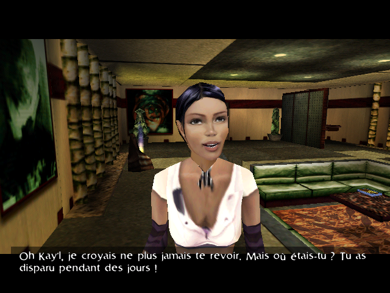

# 7. Conversations and cutscenes

← [Contents](README.md) · prev: [Actors](06-actors.md) · next: [Rendering](08-rendering.md)

---

## In short

A conversation is a small graph. Each node is one line somebody says, with up
to four replies. Each reply has a condition that decides whether it is offered
and an action that runs when you pick it. The text, the branching, the voice
recording and the facial animation all ship together, and so do the cameras:
a conversation carries **its own**.

A cutscene is not a separate system. It is the same scene machinery the rest of
the game runs. A chunk's startup script plays a sequence of scene **objects**.
Each object is a small program that animates a character, a door or a prop, and
some objects have a **camera editing** attached: a recorded camera move that
takes over the view while the object plays. A second family of cutscenes has no
editing at all. A world script cuts and travels between ordinary world cameras,
and the game's own title sequence is one of these.

Four rules run through all of it. Each one was learned by getting it wrong:

* **A shot lasts as long as its editing**, not as long as the animation inside
  it.
* **When an editing ends, the camera stays where it is.** It holds the last
  frame until something asks for another camera.
* **A spoken line changes a character's pose, never their position.** The line
  plays over wherever the scene already put them, and the speaker does not
  walk while he talks.
* **Not everything that waits is a cutscene.** A sliding door and a gunman's
  entrance park a script exactly as a cutscene beat does, and neither takes
  the player's control. The black bars at the top and bottom of the screen mean
  one thing: *you are not in control right now*.

  
   <em>The original engine's own framebuffer during dialog 402: the 64-row
  letterbox bands, with the line's subtitle lighting the bottom one
  (<code>docs/UI.md</code> §3j).</em>

## In detail

### The conversation format

`IAM\DIALOG` holds 321 conversations in 420 chunks, with 1 174 nodes and 1 923
cameras between them (`docs/FILE_FORMATS.md` §2; `verify.py: conversations`).
A node is 64 bytes. Its nine pointers group onto the four branches, and tracing
settled which half is which, where the first attempt had only guessed. The
event raised while the reply menu is being built (55) **evaluates** `ptr[0..3]`
for a value, so those are the conditions. The event raised when a reply is
chosen (59) **executes** `ptr[4..7]`, so those are the actions. The ninth
pointer is the node's string pool: six strings, namely the line itself, four
reply texts, and a line the *player* speaks to open the exchange
(`docs/FILE_FORMATS.md` §7).

**An action reaches the world like any other script.** Event 59's context is
"throwaway" only in how long it lives. It is a real context in the active slot:
it runs once through every handler and is then freed. So a reply that runs
`zone.disable` re-registers the live zones, and `object.show` reaches its prop.
Until 2026-10-05 the port ran the actions in a bare interpreter on the database
alone. A conversation that retired its own trigger could then be started again
from the same spot, and an object a reply gave you was lost, a loss the next
save kept (`docs/FILE_FORMATS.md` §7; `todo/drift-audit.md` S2;
`verify.py: engine: reply action`).

A golden trace of the original can see the menu being built. A condition that
reads a variable logs it, and node 12 of conversation 402 reads `669 668 667`,
`671`, `670` in branch order, exactly the batch `traces/telis-dialog.log` holds
(`verify.py: telis dialogue`).

The node's 10-byte name is the stem of a `.3DM` file in `MORPH/`, which carries
both the voice and the lip-sync. 750 of the 779 `.3DM` files present are named
by a node (`docs/FILE_FORMATS.md` §2).

Exactly one opcode launches a conversation: `dialog.start` (op 61). It has
1 246 sites (1 001 in `IAM\AREA`, 84 in `IAM\SCENE`, 161 in `IAM\GLOBAL`), and
every operand names a real conversation (`docs/SCRIPT_VM.md`, "How a
conversation is launched"; `verify.py: dialog.start sites`). The street's
passer-by talks are conversations too. Their speaker is `-1`, which resolves to
a per-city stand-in actor that nothing stages, so the shot frames the player
and the walker he is talking to (`docs/STREET_LIFE.md` §3; chapter 6).

### One line, two cameras

A conversation's cameras are 44-byte records, and each is a **fixed
viewpoint**: an eye and a look-at point, not a move (`docs/FILE_FORMATS.md` §2,
"DialogCamera"). A node names two pairs of them, one for the line and one for
the reply menu. `Dialog_ApplyLineCameras` issues each pair as a **cut** to the
first camera followed by a **travel** to the second over **160 frames**. That
is 5.3 seconds at 30 fps, which is why the camera stops moving well before a
long line has finished. 1 237 of the 2 348 camera slots name a real pair, and
the two ids are almost always consecutive, so they were authored as a "from" and
a "to" (`docs/FILE_FORMATS.md` §2, "One line, two cameras").

**The travel eases in and out.** The 160-frame move is curve type 1, two
quadratic halves, where the port had been linear. The angles are whole degrees,
truncated as `Dialog_Load` stores them: 95 of the 1 923 rolls move by half a
degree or more. The near plane is the engine's 2.0. All three differences were
found by comparing the camera chain end to end with the original on
2026-10-01, and ported (`docs/RECONSTRUCTION.md`, 2026-10-01; `verify.py:
dialogue camera blend`). Every *script* camera move, by contrast, is linear:
all 1 019 `camera.set.wait` sites ask for type 0 (`docs/CUTSCENES.md` §4b,
"The clock a world-camera move runs on").

The look-at point is an **aim**, not the subject's position. It sits a fixed
768 raw units from the eye on 1 615 of the 1 670 absolute cameras. What does
locate a speaker is where a conversation's line cameras **meet**. For dialog
402 the camera bundle meets 2.4 units from a position solved independently from
a screenshot (`docs/FILE_FORMATS.md` §2, "The look-at point is an aim";
`verify.py: dialog 402 vs game`).

Each point's subject field is a **resolver kind**, not a boolean. It is `-1`
for an absolute set coordinate. Otherwise it names both *which* speaker and
*where on them* the point anchors (`docs/FILE_FORMATS.md` §5c, "the RESOLVER
KIND"):

| kind | speaker | anchor |
|---|---|---|
| 0 | first | the actor record's own position |
| 1 | first | the `Tete` node, the head |
| 2 | second | the body node's world origin |
| 3 | second | the head node's world origin |
| 6 | both | the two-shot |

Across the shipped file, 253 of the 1 923 camera points are not absolute. They
split **20 / 92 / 24 / 84 / 33** over kinds 0 / 1 / 2 / 3 / 6, so **176 of
the 253 anchor on a head**. Kind 2, the only kind the first reading covered, is
the rarest of the four body and head kinds. That is why a camera authored 40
units in front of Kay'l's face ended up at chest height inside him
(`verify.py: dialogue camera subject`).

A travel interpolates more than the two points. It interpolates the eye, the
target, the **roll** and the **fov**, so a pair whose fov differs sweeps rather
than cuts: 402's `4572 → 4574` runs from 84.99° to 99.58°
(`docs/FILE_FORMATS.md` §5c).

**The dialogue cameras take no obstruction pass, and do not need one.** Only a
camera whose eye subject is 0 gets the collision pass, and
`Dialog_ApplyLineCameras` explicitly clears the pass's flag on both of a line's
cameras. Switching the pass off moves 0 frames of dialog 387's 22 shots
(`docs/ASSETS.md` §7, "The obstruction pass"; `verify.py: engine: camera
obstruction`). What clears the lens is the **back-face cull**, found on
2026-10-01. `Render_SubmitMesh` drops every face whose screen winding is
backwards, above a device set to cull nothing. The restaurant lunch's crane has
its eye above the ceiling, and another of 402's cameras sits behind a wall:
from those positions the scenery is seen from behind and not drawn. A reader's
capture of the original shows one layer of vivarium glass where the port had
drawn two, and the culled render matches it patch for patch. The cameras
themselves had been placed exactly all along (`docs/RECONSTRUCTION.md`,
2026-10-01; `verify.py: engine: back-face cull`; chapter 8).

### What a line does to a body, and what it does not

The line's `.3DM` drives a pose, and the morph player blends that pose into and
out of whatever the character was already doing. The fade takes
**`min(30, frames × 0.25)`** frames at each end: a per-node quaternion slerp,
with the weight quantised to k/256. The one line whose name contains `02E19A`
fades in only (`docs/FILE_FORMATS.md` §5c, "How a line BLENDS"; `verify.py:
engine: pose blend`).

The line's **root rotation** is applied, not cancelled. The per-frame applier
points the root track at a two-key array of its own, an identity and then the
line's root rotation times the heading `Morph_Play` latched, so the pelvis
receives the line's own rotation, turned by the scene's heading. All 19
recorded rotations reach the skeleton. That is why the game bows a speaker's
whole body toward the camera: on line `125339` the pelvis-to-head pitch is 47°
with the root kept and 3° with it cancelled. It is also what keeps a seated
speaker's heading through a line (`docs/FILE_FORMATS.md` §5c).

*That paragraph was corrected on 2026-10-02.* The previous manual explained the
applied rotation as an accident: an index, `g_MorphRootTrack`, that the code
initialises to −2 and was thought never to write again, so the replacement
"could not fire". The index is in fact written per line by the demuxer, through
a context pointer, which a search for the global's name cannot see. The
conclusion (applied, not cancelled) survived; the mechanism given for it did
not (`docs/FILE_FORMATS.md` §5, "Two loose ends").

The **heading** is taken once. `Morph_Play` reads the node's world yaw, less
the actor's Euler, at the line's start, and holds it for the whole line,
whatever the scene program does afterwards. The port got this wrong four times
in a day, and each time a transition caught the error where a still frame
showed nothing:

* with no yaw at all, a speaker snapped 80° when her idle came back;
* with the Euler but not the clip's root yaw, she stood about 90° off the
  engine's own frame of the greeting;
* re-reading the yaw every tick snapped her by about a hundred degrees when her
  scene program ended mid-line;
* composing the yaw after the fade instead of before it turned her twice at
  one end of the fade and once at the other.

(`docs/RECONSTRUCTION.md` log, 2026-09-06; `verify.py: line facing`, which was
mutation-tested against the first and third readings.)

The **root translation** never sets the body's position. The write that looks
as if it would store it lands on the root track's position-key pointer, which
nothing that applies a frame reads. The translation is used as an offset from
an origin **latched once at the line's start**. A line therefore moves a body
*from where it already stands*, and the scene's own placement stays under it
(`docs/FILE_FORMATS.md` §5c). Weighting that placement by the line/idle fade
made a speaking character drift back to her bare staged spot and swing there
and back. A reader watching Telis in the restaurant described it as *flying*.

**And the body does not walk during a conversation.** `Actor_TickDialogue`,
which runs states 16 and 17, is the channel tick plus the zone scan, with no
motion pass. Walking into Telis's zone left Kay'l mid-stride, and the port then
slid him 2.8 units into camera 4554, which sits nine units from his head, so the
first line framed the back of his head. The controller now does what the engine
does (`docs/RECONSTRUCTION.md`, 2026-10-02; `verify.py: engine: dialogue stands
still`).

**The simulation follows the voice.** While a line's voice plays, `Game_Frame`
replaces its frame delta with the advance of the voice's own play position, and
the face is sampled at that clock. This path has no three-frame cap. On a slow
machine the scene therefore keeps pace with the sound, rather than the sound
running ahead of a scene held back by the cap (`docs/BOOT.md` §4;
`todo/drift-audit.md` T2; `verify.py: engine: line sync`).

### Cutscenes: beats and editings

A scene's beats are started by the chunk's own **startup script at `+4`**.
`Area_TickLoad` queues it the moment the chunk loads, once for the AREA block
and once for the SCENE block. 173 chunks carry one, and all 173 disassemble
cleanly (chapter 5; `verify.py: startup scripts`). For the Impasse, the game's
first cutscene, SCENE 55's script fires all **sixteen** beats in authored order
and then hands off with `scene.load(237, 57)`. 19 of the 21 events it would
announce appear in `traces/intro.log` in order, and both missing ones are
explained (`docs/CUTSCENES.md` §5, "What orders the beats — CLOSED";
`verify.py: impasse beats`). The question stayed open for a while because the
5 785-slot script inventory never enumerated `+4`. A negative result over a
corpus is only as strong as the enumeration behind it.

The mechanism that makes a cutscene run without the player is one status word.
`scx.play*.wait` writes 4 into the script context's status, a per-frame scan
resumes it when the object finishes, and nothing in that loop reads input. The
`scx.play` family runs at 3 025 sites, 2 043 of them `.wait`
(`docs/CUTSCENES.md` §3; `verify.py: scx.play family`). "Take the body" is
literal. During `player.anim.hold` the beats drive **the player's own actor
node**, and a frontend that draws him through a separate controller loses him
from the shot (`docs/CUTSCENES.md` §4; `verify.py: engine: player program`).

**Which body a step moves is decided by name** (read 2026-10-06). The two
body-animation functions take no actor. They resolve their node from a name in
the object's string table, and the opcode that started the object pins only one
slot. Of 1 451 shipped objects with a body step, 5 are started plainly and find
every body by name. That set includes Gandhar's snake rising out of the lava
and the bodies on the morgue's slabs. 69 objects name two or more nodes
(`docs/FILE_FORMATS.md` §5c, "WHICH BODY a body-animation step moves";
`verify.py: engine: gandhar play`).

Some objects have a **camera editing** linked to them: a recorded move in the
scene file's chunk 10. 29 scenes carry one, with 125 editings and 24 112 frames
in all. 95 editings are linked to an object, and 30 ship unlinked
(`docs/CUTSCENES.md` §2; `verify.py: cutscene links`). While an editing drives,
it is sampled at *the object's own program clock*, so the camera and the
animation cannot drift apart. The sample is taken **before** the tick advances
that clock, so an object's first drawn frame is key frame 0. The port carries an
independent transcription of `Cam_PlayEditing`, and it agrees with the Python
reader on all 24 112 frames to 0.002. Shifted by one frame, the same comparison
fails on 20 351 of them, which shows the test can fail (`docs/CUTSCENES.md` §5;
`verify.py: engine: cam mode 13`).

Three things happen at the end of an editing:

**The shot lasts as long as the editing.** `Script_PlayScript` stops an object
only when both its step chain and its editing are done. A replica that required
the program to be running dropped the tail of a shot: `C_1_BoxMoves` spends its
steps by frame 110 of a 185-frame editing (`docs/CUTSCENES.md` §2).

**The camera holds.** The engine's fallback that puts the camera back on the
player is gated on the ini key `autocameraplayer`. It is read with a default of
`"0"`, and nothing else in the image writes it. So in a shipped game **the view
freezes on the editing's last frame** until something issues a camera request.
Cutting back to the last world camera instead drew **0 of 480 000 pixels lit**
in every gap between beats (`docs/CUTSCENES.md` §2; `verify.py: engine:
editing hold`). *Any* request ends the hold, including one for the camera
already installed, because `Camera_RequestChanged` compares the mode first. A
port that watched the camera id instead left the view parked on the
supermarket's medical editing for the rest of the game (`verify.py: engine: hold
release`).

**And nobody takes the body.** Between two beats no program drives the
characters, and none needs to: each node keeps the pose and place its last step
left. **A finished animation does not re-pose** either. On the tick a run count
is spent, the engine returns without writing the node. The port once snapped
bodies back to their clip's start for a frame at the end of every beat. A held
pose must also be held with its yaw, or it turns twice. Measured on the body,
the Impasse's 17 jumps fell to 3 (`docs/CUTSCENES.md` §2, "And the BODY between
two beats"; `todo/omk-play.md` 78; `verify.py: engine: beat handover`).

**An actor is driven by one scene program at a time.** Starting a second program
on the same actor stops the first. Appending instead left a looping idle
fighting the new beat for the same body (`engine/README.md`, "An actor is
driven by one scene program at a time").

**Some cutscenes are in black and white.** Ops 150 / 151 swap the renderer's
bank to one that converts every vertex colour to luma grey, at 14 shipped
sites, among them the morgue and the concert. They run on every backend since
2026-10-06 (`docs/SCRIPT_VM.md`, "150 / 151"; `todo/drift-audit.md` S11;
`verify.py: engine: grey bank`).

### The other family: world-camera cutscenes

A world script can direct a sequence with no editing at all. `camera.set X, 0`
**cuts** and `camera.set X, t` **travels** over `t` frames, the same move model
as the dialogue cameras. **106 world scripts** do this with six or more moves
and at least ten seconds of travel. The most important is the game's own title
sequence, AREA 0 record 78: 4 370 frames (**145.7 s**), 46 moves, over
`music.play 3`, a 143.8 s track (`docs/CUTSCENES.md` §4b; `verify.py: camera
scripts`).

**The move runs on the frame delta, not on frames counted.** The engine adds
the frame's delta to the move's clock, and the event that ends the move also
releases the parked script. A slow machine therefore takes bigger steps and the
sequence stays on the music down to 10 fps. The port counted ticks until
2026-09-30, and on a console at about 15 fps each move took twice its length
(`docs/CUTSCENES.md` §4b, "The clock a world-camera move runs on").

Most of the game's scripted camera work is framed on an actor: the camera is
actor-relative in **1 708 of 2 853 cuts** and **715 of 1 674 travels**. The cut
count was 1 707 of 2 852 until op 142's length was corrected on 2026-10-11 and
one more `camera.set` decoded (`docs/CUTSCENES.md` §4b). A world camera's two
subject fields are **kinds**, like a dialogue camera's (read 2026-10-05). Kind 0
is the request's actor. Kinds 1 and 3 are the player's **head**, which covers
the medium shot and the close-up the scripts ask for at about 140 sites. Kind 9
is an **address**, used by the four cameras on the rooftops' ladders. The port
had anchored all of these at the pelvis or the player (`docs/FILE_FORMATS.md`,
"The subject fields are KINDS"; `todo/drift-audit.md` S14; `verify.py: engine:
head camera`, `engine: address camera`).

The roll field wraps. It is stored in 4096ths of a turn. Wrapped to (−180, 180]
and interpolated along the short arc, 0 of 638 moves roll more than 90°
(`docs/CUTSCENES.md` §4b; `verify.py: camera scripts`, `camera roll`).

### The voice-overs

Most of the voice-overs are placeholders, and that is a decision the engine
makes, not something missing from the tree. `media.play` builds a
`VOICEOFF\*.ADP` name from an `IAM\OBJECT` record. When the name starts with
`ZVOT` or `ZVOP`, it substitutes `JINGOFF3.ADP`, a 2.08 s jingle. Of 561 ZVO
objects, **10 have their own shipped file, 520 play the jingle and 31 are
silent**. One voice plays at a time, because each `media.play` stops the one
before (`docs/CUTSCENES.md` §5, "Music, and the missing voices"; `verify.py:
engine: voice over`). The question is **closed** (`docs/PRACTICE.md` §6). The
dialogue voices are a different thing and are present: per-frame ADPCM inside
each line's `.3DM` (chapter 9).

### Staging a character

Where a scene program places a body depends on which of two functions the
object uses, and they do not agree (`docs/FILE_FORMATS.md` §5c, "How the two
body-animation functions PLACE the character"):

* `Script_SelectBodyAnimation` (545 uses) snaps the node to the clip's **root
  key 0**, the authored placement, and adds the per-frame deltas from there.
* `Script_SelectRelativeBodyAnimation` (2 398 uses) never reads the clip root.
  It places the character on an authored **`.3DP` path** named by two of its
  own parameters, minus an offset given in three more.

Both were once read as the first. For dialog 401 that reading put Telis 365
units from where her path puts her. Both functions then move the body by the
same summed root deltas.

Every body-animation step also writes the actor's **Euler**, and that Euler is
what turns the clip's root motion. Read as sticky, it made the restaurant
waiter's walk cycles run at his standing wait's 145°, which sent him through the
walls. The invariant that settles it comes from the corpus: a program's steps
**chain**, so a correct reading re-places the body where it already stands. Over
the restaurant's 68 hand-overs, the mean gap is 0 units and the worst is 2. Read
as sticky, the mean is 28 and the worst 628 (`docs/FILE_FORMATS.md` §5c;
`verify.py: engine: scene facing`).

A path can also be **turned into the set**. One lift or door is authored once,
and the halls install it at their own angle: `Script_MoveObjectOnPath` rotates
the whole path about its first key by three degree parameters before placing
anything. 854 of the corpus's 4 841 calls carry an angle. 851 of them turn about
Y alone, and the other 3 have Y zero and a nonzero X or Z
(`docs/FILE_FORMATS.md` §5c, "TURNED INTO THE SET"; `verify.py: engine: path
turn`).

**Hiding a body and showing it again does not reset it.** `character.show`
applies the record's position and facing only when its second field is non-zero.
With 0 it re-links the same node where it last stood, as it last stood. The port
had rebuilt the body at its placement record, and a body with no `.CTL` came
back in its T-pose (`todo/drift-audit.md` M1).

### The letterbox, and what "a cutscene" means to the player

The engine's 1.818:1 **letterbox** uses the same two 64-row bands its screen
fade draws. The captures decide when it shows. Every letterboxed frame in
`traces/frames` is one the player does **not** control: conversations, and the
intro cutscene on a scripted world camera. No interface frame has it
(`docs/UI.md` §3j). The rule that holds up in play has three terms: *no
control, and not held, and the fade actually darkening the bands this frame*.
It took three rounds, and play refuted each earlier version (`verify.py:
letterbox`):

* keyed on the follow camera, the bars never came off at a door that left an
  absolute camera up;
* keyed on control alone, they came off before a scene's closing fade and
  snapped instead of fading;
* keyed on a fade being armed, they never came off after a boot, because AREA
  118's startup script arms one and never clears it.

The original only ever ran at 4:3, where the fade's bands and the 1.818:1 strip
are the same rows. On a wide frame they part: at 1920×1080 the strip is 12 rows
and the fade's formula gives 144. Since 2026-10-20 the port sizes the fade's
bands from the width, like the strip, which is identical at 4:3 (`docs/UI.md`
§3j).

Two things that look like cutscenes are not, and a reader flagged both:

* **A gunman's entrance is gameplay.** In the engine, only `player.anim.hold`
  blocks the player's input. `camera.set` and `scx.play*` do not, and
  `scx.play*` requests the editing camera only for an object that has an
  editing linked (`todo/shoot-mode.md` §5c).
* **A sliding door is not a beat.** A waiting `scx.play` on a door parks its
  caller exactly as a beat does. Treating "a script is parked on a program" as
  a cutscene brought the bars down and hid the player for the length of a door
  (`todo/omk-play.md` 89).

### The port on the console

These changes are to how the port does the work. The findings above are
unchanged.

* **On the GLES backend (the Vita's), staged bodies are posed on the GPU**:
  scene actors, and a speaker between lines. The exception is a speaker whose
  line is morphing the face. That speaker stays on the CPU, because the face's
  130 vertices move one by one. Compared against the CPU path on the Mac, the
  GPU path differs by 0 to 36 pixels depending on the scene. No `verify.py`
  check asserts this (`todo/gpu-skinning.md` step 4).
* **A line's `.3DM` is read once**, and on the console the lines after a
  conversation's first are **read ahead** on their own thread. The stalls at
  cutscene hand-overs were whole-file reads from the memory card, and
  transitions no longer do those reads within a single frame
  (`todo/vita-port.md`). A line can also be **streamed** rather than read whole
  (`todo/handoff-classic-mac.md` 3f; `verify.py: engine: line stream`).

## Where it lives

| | |
|---|---|
| the findings | `docs/FILE_FORMATS.md` §2 (the format), §5 (the `.3DM` loose ends) and §5c (resolver kinds, which body a step moves, the two body-animation functions, turned paths, the line blend, world-camera kinds), §7 (event 59); `docs/CUTSCENES.md`; `docs/ASSETS.md` §8 (dialogue cameras) and "The obstruction pass"; `docs/SCRIPT_VM.md` (op 61, ops 150/151); `docs/BOOT.md` §4 (the line sync); `docs/UI.md` §3j (the letterbox) |
| the records | `todo/drift-audit.md` (S2, S11, S14, M1, M2b, M3, T2); `docs/RECONSTRUCTION.md` 2026-10-01 and 2026-10-02 |
| the port | `engine/src/script/dialogue.*`, `scenerunner.*`, `program.*`, `linesync.h`; `engine/src/o3de/camedit.*`, `worldcam.h`; `engine/src/actor/pose.h`, `speaker.*`; `engine/src/audio/voiceover.*` |
| the viewers | `/dialog` and `/cutscene` in `tools/omkweb.py` |
| the checks | `conversations`, `telis dialogue`, `dialog.start sites`, `engine: reply action`, `dialogue camera subject`, `dialogue camera blend`, `engine: back-face cull`, `engine: camera obstruction`, `engine: pose blend`, `line facing`, `engine: dialogue stands still`, `engine: line sync`, `startup scripts`, `impasse beats`, `scx.play family`, `cutscene links`, `cutscene camera`, `engine: cam mode 13`, `engine: cam editings`, `engine: editing hold`, `engine: frame hold`, `engine: hold release`, `engine: beat handover`, `engine: player program`, `engine: gandhar play`, `engine: grey bank`, `engine: scene facing`, `engine: path turn`, `camera scripts`, `camera roll`, `engine: head camera`, `engine: address camera`, `engine: voice over`, `letterbox`, `dialog staging`. `python3 tools/verify.py --list` names 651 checks (2026-11-02) |

## What is not settled

* **Where the body stands during a line is checked only in part.** `engine:
  pose blend` asserts the pose half only. `engine: dialogue stands still` holds
  the player's feet through a conversation (`docs/RECONSTRUCTION.md`,
  2026-10-02). No check holds a *scene-staged* speaker's placement under the
  line's root translation; that rule rests on the reading and on play
  (`docs/FILE_FORMATS.md` §5c; `todo/omk-play.md` 81).
* **What the line's translation and node slots 0 and 1 carry.** The `.3DM`
  frame's `float[3]` and the two unbound node slots are not established
  (`docs/FILE_FORMATS.md` §5, "Two loose ends"; `docs/PRACTICE.md` §6).
* **Three placement jumps at beat *starts*** in the Impasse have not been read.
  At each, a new object snaps a character to its own clip's root key 0, which
  is what the engine does, but nobody has established whether those three
  placements were authored that way. The check pins the count so that if one of
  them is a fault it cannot be fixed by accident (`todo/omk-play.md` 78;
  `verify.py: engine: beat handover`).
* **The 3 turned paths that turn about X or Z** are counted and left alone,
  because their Euler order is not established (`docs/FILE_FORMATS.md` §5c).
* **The editing's travel blend** between the last drawn camera and the
  editing is a reconstruction. The shipped startup scripts exercise it for at
  most one frame, so the data cannot confirm or refute it. Editing roll is
  sampled but not applied (`docs/CUTSCENES.md` §5).
* **The letterbox rule** agrees with every capture but is the port's rule, not
  the engine's own. The camera block's viewport fields, which would give the
  engine's answer, are not read (`todo/fight-mode.md` 15.4; `docs/UI.md` §3j).
* **105 of the 321 conversations are launched by no script.** The data favours
  the reading that they were cut late: 14% of them have their facial animation,
  against 68% of the launched ones, while the text is written for both
  (`docs/PRACTICE.md` §6; `verify.py: unlaunched dialogs`). That is a
  correlation, not a proof. See chapter 13.
* **The 0.25 in the voice clock's formula** (bytes or samples) is not traced
  (`docs/BOOT.md` §4).
* **The `/dialog` web viewer still stages from the clip root** for objects that
  use the relative function, still cancels the line's root rotation, and cuts
  to the idle without a blend. These are viewer conveniences that the engine
  does not have, and they are labelled as such (`docs/FILE_FORMATS.md` §5c).
* **The GPU posing of staged bodies has no check** and has not been compared on
  a console. What exists is a pixel comparison on the Mac
  (`todo/gpu-skinning.md` step 4).
