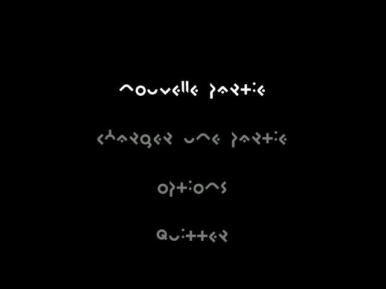
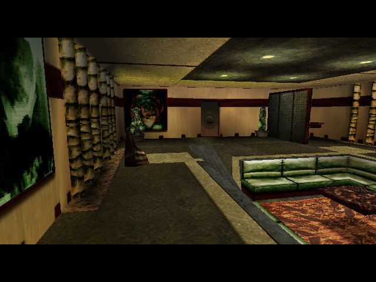

# 8. Rendering

← [Contents](README.md) · prev: [Conversations and cutscenes](07-conversations-and-cutscenes.md) · next: [Audio](09-audio.md)

---

## In short

The original draws through Direct3D in its 1999 fixed-function form: it hands
the driver vertices it has already transformed, culled and lit, with a
texture, and the driver fills the triangles. A set is *pre-lit*: every vertex
carries a colour baked into the file. What is lit at run time is the
characters, the props and the street's moving population, by a table of lights
that ships inside the set's model.

The port has to draw that picture, not a better one. On a 3D card the original
filters its textures **bilinear** with no mipmaps, **dithers** to a 16-bit
framebuffer, and turns anti-aliasing **off**. It also throws away every
triangle that faces away from the camera, in its own code, before the driver
sees it. That last fact was misread for a month: the device's own cull setting
is "none", and the port drew the backs of walls the original sees through. A
character's shadow is not a shadow pass but a soft blob copied under a few
bones. The far skyline shimmers on the frame clock. The fog takes its colour
from the area and the hour. In a few cities it rains or snows. A handful of
cutscenes are drawn in black and white.

The interface is a separate world: a 16-layer display list blitted with a
colour key. A blit is a memory copy, so the 2D half is reproduced pixel for
pixel. The 3D half is judged only on **silhouette and coverage**, and for
**one camera** so far. No claim is made about the value of any 3D pixel.

The port draws through one boundary, at the level of **decisions**. Six
renderers stand behind it:

* a software rasterizer that the checks measure;
* Vulkan, for the desktop;
* OpenGL ES, for the PS Vita, the Meta Quest and a desktop window;
* fixed-function OpenGL 1.x, for the PowerPC Macs;
* citro3d, for the Nintendo 3DS;
* an OpenXR host that puts the Quest's eyes on the GLES renderer.

None of the GPU backends has an evidence tier of its own. Each is held to the
software reference.

Everything the original did not draw is in one of three opt-in tiers, all
**off by default**:

* the **enhancements**: anti-aliasing, mipmaps, better shadows, per-pixel
  light;
* the **restored weather**: two cities' showers and a sandstorm the game wrote
  and never switched on;
* the **remaster**: new textures, reflections, mist, wet streets and much
  more. It is compiled only into the desktop and Quest builds.

## In detail

### What is ported is decisions

The interface between the engine and a backend (`docs/PORTING.md` A2):

```
begin(view)                        the camera and its frustum
submit(draw)                       {bucketKey, mesh, range, blend, cutout}
submit2d(I2dList)                  the display list, already ordered
end() -> Frame                     RGB565, 640x480
```

A backend receives decisions and turns them into API calls. It never makes
one. The decisions are the port:

* **the drawable mask**, `flags & 0x800043` (`docs/ASSETS.md` §4b;
  `drawable mask`);
* **the 14-bit bucket key** that orders every draw. Its texture is the key's
  low six bits, and `mesh 0x10000` *assigns* the state rather than OR-ing it,
  wiping the bits set before it (§4b; `render bucket key`);
* **two blend modes**: `0x1000|0x2000` additive (211 meshes) and
  `0x1000|0x4000` multiply (6 meshes). The multiply is `dst × (1 − src)`, and
  `0x800` is a separate cutout path (§4);
* **the 58-slot texture cache**, matched on a 19-character name (§4b);
* **the visible-set walk**: the hidden bit, a sphere-distance cull and four
  side planes (`sub_48D3B0`, §4b).

PORTING A2 gives the reason the line sits there. At the API level the ported
decisions would leak into backend code, and a second backend would mean
extracting them all over again.

The line has held through six backends. Since 2026-10-13 the CPU halves the
GPU backends share live in one file, `o3de/drawcore`: the pose, the light law,
the tie bake and the blend rule. Each backend keeps only its API calls.

### The render states: two arms, and the port took the wrong one first

`sub_4638C0` sets the device's render states once, and it has **two arms**
(`docs/ASSETS.md` §4b, corrected 2026-10-03). The arm this repo read first,
in 2026-09, is the **software** devices' arm: point sampling, no mipmaps,
`ANTIALIAS` explicitly off, dither on.

The arm a **3D card** takes sets `MAGFILTER` and `MINFILTER` to **LINEAR** and
`MIPFILTER` to NONE, keeps dither on, and never sets `ANTIALIAS`. The driver
option indexes the Direct3D devices the game enumerated. A card is mode 0, and
mode 0 is the boot default. So a player with a 3D card saw **bilinear-filtered
textures, no mipmaps, dithered, no anti-aliasing**. The misreading was found
while modelling the OpenGL 1.x backend on the original's Direct3D path.

What followed for the port was the reader's decision: "the default should be
what the original does".

* Every GPU backend filters bilinear by default: Vulkan, GLES and GL1.
* The software reference stands where the software devices stood, and
  point-samples. That is also what the original drew in modes 1 and 2.
* Trilinear filtering stays an enhancement, because both arms set MIP NONE.
* MSAA stays an enhancement, because neither arm turns anti-aliasing on.

`render states` asserts both arms. `engine: texture filter` asserts the
resolved default and the GLES half; `engine: gl1 backend` asserts the GL1
half. One limit is recorded: GL1 cannot divide in fixed function, so a filtered
cutout edge keeps up to half the key's black.

**The dither is a fidelity fix, not an enhancement.** The port had drawn hard
565 bands where the original drew dithered noise. The dither is on by default
in every backend, applied at the single 888 → 565 quantisation point
(`engine/src/ui/surface.h`). The *decision* is ported. The 4 × 4 ordered
matrix belonged to the player's card, so it is a **labelled reconstruction**.
`engine: dither` holds it to what can be checked: a 4 × 4 block reconstructs
its input to 0.491 of 255, against 2.047 for plain rounding, at a bias of
−0.249 (`docs/ASSETS.md` §4b).

**Before building an enhancement, check whether the game already does the
thing and the port dropped it.** The dither, the shimmer and bilinear
filtering all turned out to be that case.

### The original's software devices, read but not ported

`Raster_DrawTriangles` hands mode 2 to the game's own software rasterizers.
These were read on 2026-10-05 from the decompilation and the assembly, not
run (`docs/ASSETS.md` §4b "What draws it"; `todo/cpu-vs-original.md`). There
are six triangle routines chosen by the key: opaque, cutout, a 50% average,
cutout + 50%, saturating subtract and saturating add. Their picture is
coarser than the card's:

* the light is a **luminance**;
* the fog is folded in per vertex;
* the dither is a 2-pixel checkerboard;
* the 16-bit z is constant across each 16-pixel run.

The port's software reference does **not** reproduce that picture. It
reproduces the *hardware* picture: coloured light, per-pixel fog. It is a
reference implementation standing where Direct3D stood, not a port of the
mode-2 rasterizer.

### The back-face cull, done in software above the device

`SetRenderState(22, 1)` puts the device at `D3DCULL_NONE`, and for a month
this repo read that as "the engine never culls". But `Render_SubmitMesh`
(0x004951C0) has already tested every face's **screen** winding before the
device sees it (`docs/ASSETS.md` §4; engine/README "The back-face cull"):

* a face whose winding is backwards is dropped;
* a mesh flagged `0x20000000` is the exception. That flag is on 93 of 16 188
  meshes, nearly all water;
* the near-clip path and the second submit test the same way;
* the mirror pass's X flip comes later, so the test always sees the unflipped
  winding.

A reader found it by noticing that dialogue cameras looked blocked by the
scenery. A camera authored behind a wall, above a ceiling or inside a head is
*meant* to see through it. The cases are dialog 387's crane, dialog 402's
cameras 4577 and 4575, and the lift's black arrival inside the car mesh
`CSPont04`. The fix landed 2026-10-01 on every backend:

* `raster.cpp` drops the face;
* Vulkan discards on `gl_FrontFacing`;
* GLES toggles `GL_CULL_FACE` through its state cache.

Each GPU sign was **measured** against the software render. The wrong one
turns Aapkayl inside out: a Vulkan mean colour difference of 137.8 against
3.3.

**Tier**: the rule is 6, read from three functions. One shot is *indicative* of
4. Camera 4575's eye is inside the vivarium glass, and a reader's capture of
the original shows one layer of glass where the port had drawn two. The check
is a tier-3 control of the two readings (`engine: back-face cull`).

### RGB565, and how a comparison has to be done

Measured from a captured frame (`docs/PORTING.md` A3,
`traces/frames/menu-22.png`): red carries 32 distinct levels, green 63 and blue
25 of a possible 32. The gaps are those of a 5/6-bit value expanded by bit
replication.

So comparisons are made **in 565, not in 888**. A captured frame's 8-bit values
are the *host's* expansion, not the game's data. Expanding the reference up to
888 matches the menu's title region 94.9%. Quantising the capture back down to
565 matches **66 560 of 66 560**.

### The set is lit before it ships

A set's vertices carry a **colour**, not a brightness. The engine copies the
whole dword into the vertex it hands the driver and declares `D3DFVF_DIFFUSE`
in both its draw calls. Reading only the green byte renders every set in
monochrome, and 38.9% of set vertices are not grey (`docs/ASSETS.md` §4c).

That copy is **clamped** between the scene's `+416` and `+420`. Read
2026-10-06, `+416` is the set's ambient grey and `+420` is white. The clamp
raises 3.8% of set vertices to the grey. It looked refuted by the cave's vivid
green door. The green turned out to be additive set-piece sprites that no
clamp touches, with the door the dark silhouette in front of them. The clamp
is ported and on (§4c; `engine: ambient clamp`).

**The game has black-and-white cutscenes.** A second render bank is a
six-array set swapped by `sub_42FA00`. VM opcode 150 installs it at 14 shipped
sites, against 15 restores, and 74 of the 82 instructions between them are
camera and fade opcodes (`docs/PORTING.md` B6; `render back ends`). The
*prediction* came from the bytes, and a player then confirmed it. The bank's
other four pointers were read on 2026-10-06. The whole 3D picture goes grey:
textures, clears and fog. It is ported as `o3de/greybank.h`
(`docs/SCRIPT_VM.md` 150/151; `engine: grey bank`).

### The lights inside a model, and who receives them

The table behind the 1999 press sheet's "Multilights" is real: **4 179
records of 304 bytes across 216 models**. Each record names itself `LIGHT` and
carries two radii, an RGB colour, a position and a footprint
(`docs/FILE_FORMATS.md` §5b; `mesh lights`). The count is at `desc+240`, which
lands the table on the file size in all 216 files.

A decor supplies the lights. **Two consumers** receive them (§5b, corrected
2026-10-06):

* the street's moving population, through `sub_4380B0`'s eight street-life
  call sites (`light consumers`);
* **every character and prop**, through `LightObject`, which `Actor_LoadModel`
  and `Object_Load` call unconditionally (`engine: actor lighting`).

Per vertex the light is `−(N·L)` over a linear falloff between the two radii,
through a `(t × c) >> 8` ramp. A lit vertex starts from the scene's ambient
grey, not from black. The crowd's first port had read the start as 0.

An effect never emits light. A fire brightens the frame with additive sprites,
and where a street seems lit by one, an author placed a record beside it
(§4c; `effects and lights`).

### The fog, the clock and the clip distance

The clip distance (options row 3) is in **metres** against an inch world unit.
It sizes **four things at once** (`docs/ASSETS.md` §4b):

* the visible-set radius;
* the near split, at a quarter of it;
* the far split, at 0.95 of it;
* the fog.

The fog is Direct3D **table** fog, linear, from a quarter of the clip distance
to exactly the clip distance. It is off for the near and transparent buckets,
and its range is doubled for key state `0x800`, the one mesh flag `0x10000`
assigns: the sky's (`engine fog`).

**Its colour is not always black**, corrected 2026-10-06. `sub_41E7A0` writes
the scene's `+336` every frame. It lerps the four colours at the area chunk's
`+144` by the game clock, and the screen is cleared to the same colour. The
first reading had found only the load-time zeroing and concluded "black". The
colour is still black where the chunk says so, in Kay'l's flat and the Morgue.
Anekbah runs from (95, 171, 177) at dawn to (9, 19, 26) at night, and the cave
is lava red (`o3de/daynight.h`; `engine: day night`). In the 19 areas with the
day/night flag, the ambient grey moves with the clock too.

**Under water** the scene takes a murky green fog at a 15 m clip, and the swim
camera sways. The mode is on while the camera's eye is below the water line
the swim set-up probes (§4b; `engine: underwater`).

The sky (row 4) is a flat painted **ceiling**, not a dome. The area chunk's
`+133` names one of six models, scaled 12.5×, lifted 2 250 units and moved to
the camera's x and z every frame. 17 of the 259 areas name one (`the sky`).

### The shimmer

Mesh flag `0x8000000` oscillates the vertex colour of **233 set meshes**:
distant scenery, 132 of them in Lahoreh, 0 on characters. The oscillation
reads a 32-entry signed table with `movsx`, indexed by the frame clock and the
vertex's own position, on a cycle of about 2.1 s (`docs/ASSETS.md` §4c). The
port had decoded the phase and read it nowhere. It is now drawn by default.
`shimmer table` asserts the table's three copies (header, shader, executable
bytes) against each other.

### The shadows

There is **no shadow pass** (`docs/ASSETS.md` §4d). The engine has one shipped
quad, `MESHES\MISC\shadows.3DO`: a soft disc in the multiply bucket.
`Actor_DrawShadow` writes copies of it under a fixed set of **bones** each
frame, and the options' detail level decides how many:

* arms at 2, head and legs at 1, the chest always;
* one level less for an NPC;
* nothing at a level of 3 or more.

Each blob fades by its vertex colour as the bone rises. The crowd's shadow is
a separate node at the midpoint of the two feet.

The trap is the lookup. Bones are found by `strstr`, keeping the **last**
match. A crowd model carries **four LOD skeletons side by side**, so the last
match landed on the lowest-detail skeleton. The worst bone sat 252.7 units
from its body until the search was scoped, and 22.8 after (`shadow model`,
`engine: character shadow`).

### The mirrors

Mesh flag `0x100000` is carried by **6 of 12 203** meshes. One is live at a
time, and only on a 3D card (`docs/ASSETS.md` §4). The engine reflects the
camera through the mirror's plane and **draws the whole scene twice**.

How it confines the reflection was read on 2026-09-30, and it is neither a
clip nor a stencil. The reflected pass leaves the depths of a virtual room
behind the mirror in the z-buffer. The real pass, depth-tested against them,
covers it everywhere but the mirror's opening, where the mirror's own faces
blend over what shows through. Draw order and depth do the work.

The GLES and Vulkan backends now draw it exactly that way. The software
reference still composites through a mask, which was a reconstruction made
while this was untraced. A script can **park** the mirror: ops 135/134 take it
out and put it back, and Kay'l's apartment does so on its camera cuts
(`engine: mirror park`). The plane's normal is still the port's reading,
confirmed by flying a camera across viewpoints (`mirror pass`).

### The texture cache, and the size rule

The cache hands out 58 slots from a **global** pool, matched on the texture's
19-character name alone (`docs/ASSETS.md` §4b). Two decor sets are resident at
once, so an arriving set cache-hits against the one you walked out of. **182
texture names ship with different pixels in different model files.**
`AToit` moves 121 588 pixels of an Anekbah frame depending on the resident
neighbour, in the original too (`anekbah rendered`).

Read 2026-10-11, the original also **shrinks** its textures to fit the card.
Every surface is a D3D managed texture. `sub_45F4F0` asks the card's free
video memory for room for 58 slots and halves the texture size until they fit.
A 4 MB card drew 128 × 128 textures, an 8 MB one 128 × 256. GL1 and the 3DS
apply the same rule (`o3de/texscale.h`).

### Coincident faces: the tie, the cull and the doors

Anekbah's 18 coincident shop-sign pairs are the two **sides** of a sign: the
same four vertices in opposite winding, with one advert a side. The port first
drew both sides, and a float depth test broke their tie pixel by pixel. That
was the flicker. Since 2026-10-01 the back-face cull keeps exactly one side,
so **the original never has that tie** (`docs/ASSETS.md` §4).

The port's tie machinery stays as a guard for coincident faces of *one*
winding:

* a 2⁻¹⁶ relative band in the software rasterizer (`engine: sign tie`);
* on the GPUs, the set's losers decided once per set and drawn a step back
  (`engine: gles tie bake`). Bodies keep a per-frame tie.

The tie no longer pairs a face with its reversed twin, because the cull
already keeps one.

**Door twins** (2026-11-01, `d08e0f6`). A city's set and the interior behind a
door both carry the door's leaves. Both copies are moved by one path while
both slots show, and their corners differ by about 0.001. Over Anekbah's
interiors that is 86 meshes and 931 faces. The engine's quantised buffer
keeps the first drawn. Vulkan's 32-bit depth fought over them: 13 000
flickering pixels over one opening, against 1 000 in software.

The fix is in the shared draw list, so every backend gets it. The later face
of each twin is not submitted (`o3de/settwin.h`; `engine: door twin`). It is
**reconstruction** in one respect: which z-buffer depth the engine ran on was
not read. GL1, the Vita and the 3DS were not run with it.

### The city weather

`sub_4815D0`, read and ported 2026-10-11 (`docs/ASSETS.md` §4e;
`engine: weather`). Twelve areas ship a weather type:

* **1, rain**: Anekbah, the Impasse and its airlock, the rooftops, Khonsu;
* **2, snow**: Mahaleel and one area nothing reaches;
* **3**: Jaunpur and four others. **Type 3 draws nothing**, because the caller
  tests only the snow's bit.

It runs only at **detail level 2**, and the boot default is 1, so a default
game has no weather at all.

A wall-clock cycle waits 8–14 minutes, posts message 23 and ramps to 200 drops
over 20 s. It holds, posts message 24 and fades. The area's handlers switch
the music on those messages (chapter 9). A ray 5 m up holds the weather off
under a roof. The drawing is plain 2D:

* the rain is Gouraud lines from the fog colour to grey;
* the snow is colour-keyed blits of `snow.bmp`.

Both are bounded by the whole screen, so they fall over the letterbox bands
too. Two quirks are kept: under Mahaleel's ceiling the 200 counted flakes
re-scatter every frame, a static rather than a fall; and every frame of the
fade-out scatters the drops afresh.

### The 2D layer

A 16-layer display list with seven primitives, ending in
`IDirectDrawSurface::Blt` with a colour key (`docs/UI.md` §1). The per-layer
cache is a **head** cache, so within one layer the rest draw in **reverse**
order.

Because a blit is a memory copy with no filtering, this half is exactly
reproducible, and it is reproduced (`docs/PORTING.md` B1, B6):

* the menu title: **66 560 of 66 560** pixels identical to the engine's own
  framebuffer;
* the load panel's selection outline: 1 518 of 1 518;
* the ported text: 6 132 of 6 132.

The checks are `engine: I2D blit` and `engine: text draw`.

<p align="center">
  
  <br><em>The four start-menu labels, drawn by the ported text renderer out of the<br>game's own fonts at the coordinates its widget tree gives them.</em>
</p>

### The 3D path, and what a captured frame can prove

PORTING B5: a captured 3D frame is exact about **geometry and ordering** and
not about a pixel's low bits. Filtering, dithering and the fog table belong to
the driver, and the capture was taken under Wine. So the criterion is
**silhouette and coverage**.

Rendered through dialog 402's camera 4555, the set scores **0.73 / 0.83** on
edge alignment against the two parked captures, on a chance floor of
0.27 / 0.30. 92% / 99% of the holes a set-only render leaves fall where the
capture is black, against 33% frame-wide (`docs/PORTING.md` B6;
`engine: silhouette`). That is **tier 4, for one camera in one set**.

<p align="center">
  
  <br><em>The same set through the same camera as <code>traces/frames/dlg402-47.png</code>.<br>The capture also carries a character, the props and a subtitle; the render<br>draws the set alone, which is the asymmetry the metric is built around.</em>
</p>

The one-camera limit has bitten twice. A player flying the viewer found the
rasterizer had no near-plane clipping (`engine: near clip`). Another found the
missing back-face cull (above). Neither changed a pixel through 4555.

### The backends

Every row but the first has **no tier** (engine/README §Coverage). What is
asserted is agreement with the software reference, never with the original.

| backend | where it runs | how it is held |
|---|---|---|
| **software** (`o3de/raster.*`) | everywhere; what every frame check measures | the reference. Not a port, since the engine has no software 3D rasterizer of the hardware picture's kind (above) |
| **Vulkan** (`backends/vulkan/`) | the desktop; MoltenVK on macOS | coverage against software; PORTING B6 calls it "explicitly unverifiable". Built only with the remaster switch on |
| **OpenGL ES** (`backends/gles/`) | a desktop window; the PS Vita (vitaGL); the Meta Quest's eyes | `engine: gles backend`, `gles pose`, `gles state cache`, `gles overlay` |
| **OpenGL 1.x** (`backends/gl1/`, 2026-10-02) | the classic Mac (Carbon, Mac OS 9) and PowerPC Mac OS X | `engine: gl1 backend`: coverage 0.9932, 153 pixels past 24 levels on Anekbah's street |
| **citro3d** (`backends/n3ds/`) | the Nintendo 3DS | Anekbah 99.8–99.9% of pixels within 24 levels of software, in the Azahar emulator; `engine: 3ds build` keeps it building |
| **OpenXR** (`backends/openxr/`, `src/vr/`) | the Meta Quest 2, through GLES | the head is a *render* transform on the authored camera, so game logic is unchanged; `engine: vr camera rule`, `vr frame`, `vr modes`, `vr aim` through a desktop fake headset |

Three things are worth knowing about how they differ.

**The GL1 backend is modelled on the original's Direct3D path**
(`todo/handoff-classic-mac.md` §1, 3i). It makes one draw per bucket, sets
each state only when it changes, binds the texture by `key & 0x3F`, uses
16-bit textures, and treats the colour key as an alpha test. On real Rage 128
cards (an iBook G3 and an iMac G3 under Mac OS 9) it gained several things in
turn:

* indexed draws;
* the depth tie;
* the original's texture size rule;
* vertex arrays locked around each draw (`EXT_compiled_vertex_array`);
* on 2026-11-02 (`7853dda`), **the fog on the card**.

GL1 now draws OpenGL's own linear fog, the equal of the original's table fog,
where it had folded the fog into the vertex colour with a second pass. On the
M1 the card's fog differs from the CPU fog in 11 993 pixels, none by more than
one 5-bit step (3i item 12). The handoff's comparison of the original's
Direct3D path against GL1 (3i item 11) records one difference that is
deliberate. The original clips only the near plane on the CPU. GL1 also clips
the four screen edges, because a Tiger Radeon misdrew unclipped triangles.

**Bodies are posed by the renderer** on every GPU backend: GLES and GL1, the
3DS, and since 2026-10-11 Vulkan "for consistency". A character is rigid per
mesh, so the GPU needs its rest geometry once and one matrix per mesh a frame
(`todo/gpu-skinning.md`). The software reference poses on the CPU. That keeps
every software check unaffected by construction.

**The interface over a GPU picture** is an overlay of only the rows (since
2026-10-11, the 32-pixel blocks) that changed. It is shared by GLES, GL1 and
the 3DS. The passes that *read* the world (the dims, the fades, the gauge
blends) are affine in it, so they compose on the GPU (chapter 10).

### The enhancements

Everything the original did not do is **off by default** and lives in its own
`[Enhancements]` section (`todo/enhancements.md`):

* MSAA;
* trilinear filtering and anisotropy;
* filtered interface scaling;
* an unlimited clip distance, which measures as buying nothing at 200 m;
* **fitted** shadows, the same blobs laid on the surface;
* **mapped** shadows, a shadow map from the set's own lights and the one extra
  render pass;
* per-pixel lighting by the engine's own law;
* supersampling;
* 60 fps with bodies smoothed between keys;
* **text scaling** (chapter 10).

`--enhance-all` sets them all to their top, except supersampling. Since
2026-10-05 GLES draws them too, though the Vita's vitaGL refuses MSAA and
anisotropy. Row 8, which would let the *sets* receive light, is held back on
purpose, because it would override the artists' baked lighting.

### The restored weather

A tier of its own: `[Restored] weather`, off by default and on under the
remaster preset (`docs/ASSETS.md` §4e; `todo/restore-weather.md`). It restores
what the 1999 game wrote and left unreachable.

* **Qalisar and Lahoreh** subscribe to the shower's messages with authored
  shower tracks (120 and 121) but ship weather type 0, so nothing ever posts
  the messages. The restored tier gives them the rain.
* **Type 3** has a complete sand arm behind the caller's wrong test.

What is **read** is the cycle, the roof ray, the messages and the tracks. What
is **invented, and labelled**, is the type-1 override for the two cities and
the sand's look: one grain of `sand.bmp` per drop, ramping like the rain.
The arm itself would have drawn the top-left quarter of the grain field, all
200 at once. Checks: `engine: weather` (its restored legs) and
`engine: rain 3d`.

### The remaster: a separate tier, compiled apart

The reader asked (2026-10-20) for a mode that takes the graphics as far as
they go, with the core of the game unchanged (`todo/remaster.md`). It was
planned that day and has largely been built since. Two rules shape it:

1. **A section of its own**, `[Remaster]`, outside `all = max`. It overrides
   authored art, which the enhancements are not allowed to do. Every feature is
   its own option, off by default and byte-identical at rest. `--remaster DIR`
   is only a preset over them.
2. **Generated assets never enter the repository.** The repository is public
   and an upscaled texture is a derivative of the game's data. The pipeline
   ships, and each player makes the packs from their own copy.

What it holds, each "as built" in its own section of the record:

* a texture pack, AI-upscaled from the game's own textures;
* bloom from the textures' emissive maps, with a colour grade per city;
* water reflections, reflecting floors and lit reflections;
* bodies lit by their surroundings, light from the emitters, and tiled point
  lights;
* generated normal maps ("relief");
* ambient occlusion, on Vulkan only;
* height mist;
* rounded bodies by Phong tessellation;
* FSR 1 upscaling;
* interface, font and film packs;
* a preload radius for the sets behind doors.

On top of the game's own weather it adds:

* wet floors under the open sky, with ripples and puddles;
* the same 200 drops drawn as streaks in the scene, hidden by walls and lit by
  the set's lights;
* splashes, drips, wet walls and wet bodies;
* snow lying on the floors.

Most of it is drawn by Vulkan and GLES.

**It is compiled apart** (2026-10-23, PORTING A1). `OMK_REMASTER` is defined
only by the desktop Makefile and Android's build. The Vita, 3DS, classic Mac
and PowerPC builds never define it, and its modules compile empty there.
Shared files keep one-line calls that a stub file answers.
`engine: remaster switch` shows two things: no remaster symbol in a build
without it, and Anekbah's street the same bytes with and without it.

In a build that has it, **F10** switches the original's look and the
remaster's on the running game. OMK's own options pages write the choices back
to the ini (`todo/graphics-menu.md` A, B; `docs/UI.md` §4). Several features
were "confirmed in play" by the reader and tuned by eye (the record says which).
That is the remaster's standard of evidence, and it claims nothing about the
original.

### Speed, briefly

Speed belongs to chapter 11, and its figures are labelled by machine because
they do not compare across machines. Two results bear on rendering:

* Since 2026-10-05 the software reference is about seven times faster, with
  frames identical (`todo/cpu-vs-original.md` tier A).
* On a console the city now runs near its budget. The Vita measured ~27–31 ms
  a frame in Anekbah on 2026-10-05, in a development build
  (`todo/handoff-vita-port.md` 3b4c).

The street's crowd density is the engine's own rule (`docs/STREET_LIFE.md`),
so the port draws the same characters the original did.

## Where it lives

| | |
|---|---|
| the findings | `docs/ASSETS.md` §4 (the back-face cull, the door twins, the blend modes, the mirrors, the sign pairs), §4b (the walk, the key, the sky, the clip and fog, both render-state arms, the software devices, the texture cache and size rule), §4c (colour, the clamp, the grey bank, the shimmer, the lights), §4d (the shadows), §4e (the city weather and the restored weather); `docs/FILE_FORMATS.md` §5b (the light record and its two consumers); `docs/SCRIPT_VM.md` 150/151 and 134/135; `docs/PORTING.md` A1, A2, A3, B5, B6 |
| the boundary | `engine/src/o3de/renderer.h`, `drawcore.*` |
| the backends | `engine/src/o3de/raster.*` (software), `engine/backends/vulkan/`, `gles/`, `gl1/`, `n3ds/`, `openxr/` with `vr/` and `src/vr/`, `vita/`, `classic/` |
| the decisions | `engine/src/o3de/depthtie.*`, `settwin.*`, `vertexlight.*`, `shadow.*`, `shimmer.h`, `greybank.h`, `daynight.*`, `weather.*`, `texscale.h`, `geom3do.h` (`kTwoSided`) |
| the remaster | `engine/backends/remaster/`, `engine/src/o3de/{texpack,normalmap,emitterlight,lightprobe,lighttiles,floorreflect,wetfloor,smoothbody,colourgrade}.*`, `glesrender_remaster*.inl`, `vkrender_remaster.inl` |
| the 2D layer | `engine/src/ui/i2d.*`, `surface.*`, `overlay.h` |
| the records | `todo/enhancements.md`, `todo/remaster.md`, `todo/restore-weather.md`, `todo/graphics-menu.md`, `todo/handoff-classic-mac.md` (§1, 3i), `todo/gpu-skinning.md`, `todo/handoff-vita-port.md`, `todo/handoff-3ds-port.md`, `todo/handoff-quest-port.md`, `todo/cpu-vs-original.md` |
| the checks | `drawable mask`, `render bucket key`, `render states`, `texture name cache`, `anekbah rendered`, `engine: back-face cull`, `engine: sign tie`, `engine: gles tie bake`, `engine: door twin`, `mirror pass`, `engine: mirror park`, `render back ends`, `engine: grey bank`, `shimmer table`, `engine: dither`, `engine fog`, `engine: day night`, `engine: underwater`, `engine: ambient clamp`, `the sky`, `mesh lights`, `light consumers`, `engine vertex light`, `engine: actor lighting`, `shadow model`, `engine: character shadow`, `engine: weather`, `engine: rain 3d`, `engine: I2D blit`, `engine: text draw`, `engine: silhouette`, `engine: near clip`, `engine: texture filter`, `engine: gl1 backend`, `engine: gles backend`, `engine: 3ds build`, `engine: remaster switch`. Of **651** checks in all, 397 behind `--slow` (`verify.py --list`, 2026-11-02) |

## What is not settled

* **No 3D pixel's *value* has a reachable tier.** Filtering, dither, the fog
  arithmetic and the blend maths are the driver's. The dither matrix is a
  labelled reconstruction.
* **Tier 4 covers one camera in one set.** The silhouette metric sees no
  characters or props, by construction. The back-face cull rests on tier 6
  plus one indicative capture.
* **The mirror's plane normal** is the port's reading, confirmed by play. The
  software reference still confines the reflection through a mask, which
  differs from the traced two-pass method by its read-back dither and by a far
  object.
* **The door-twin fix is reconstruction** in its depth reading, and was not
  run on GL1, the Vita or the 3DS.
* **The rain's line under Direct3D** may be clipped to the viewport rather
  than the screen. No capture settles it (`docs/ASSETS.md` §4e).
* **GPU backends have no tier at all**, by PORTING B6's rule. That includes
  GL1's fog on the card: a tolerance against the CPU fog, not against an iMac
  of 1999.
* **A latent disagreement is recorded, not fixed**: with the dither *off*,
  the Vulkan readback truncates to 565 where the software path rounds
  (`docs/RECONSTRUCTION.md`, 2026-09-09). With the dither on, which is the
  default, the two agree.
* **The remaster and the restored weather claim nothing about the original.**
  Their looks were chosen by eye, and several remaster features are confirmed
  only in play on the Mac. The classic Mac and Android builds of the
  remaster switch were not built on the machine that made it
  (`todo/remaster.md`).
* **No capture in this tree shows a shipped shadow**, so the blob's size is
  data-constrained.
