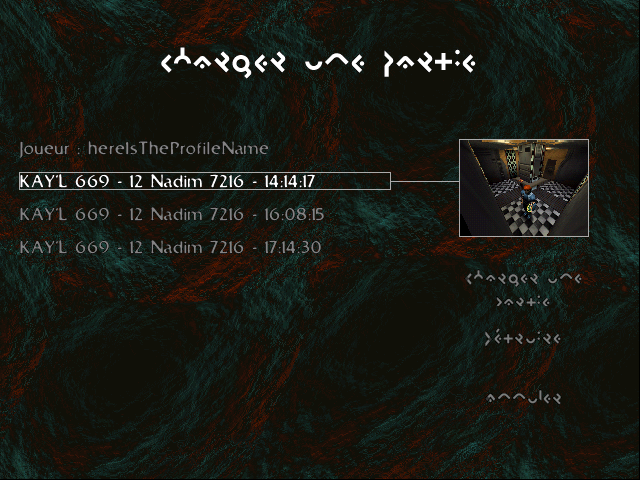

# 10. The interface

← [Contents](README.md) · prev: [Audio](09-audio.md) · next: [The port](11-the-port.md)

---

## In short

The game's menus are data too, but the data is compiled into the executable,
not shipped beside it. There are **37 screens**:

* the start menu, the options, the save and load panels and the pause;
* the shops, the terminals and the lift;
* a few one-off puzzles;
* Kay'l's handheld device, the *sneak*.

Each screen is a row in a table naming its background bitmap, its text file,
its twelve sounds and the callbacks that open, drive and close it.

What a screen *contains* is a tree. A screen owns a panel, a panel owns lists,
a list owns items, and an item is 72 bytes saying where it sits, what it draws
and which flags it carries. There are **60 panels, 176 lists and 728 items**
in all, lifted to JSON because none of it is in any data file.

Most of what makes a screen *work* is not in that tree but in small native
functions it points at: a list's input hook, an item's draw hook, the callback
a press runs. Many of them are called from nowhere but a table, so the
disassembler never recognised them as code. Nearly every screen the port
brought up meant finding them in the raw image first.

The survey of the special screens is now finished (`todo/missing-ui.md`). The start menu's OPTIONS
and QUIT, which the last revision listed as empty, now work. OPTIONS hosts the
options screen live, and QUIT ends the program. The rest of that round was
about *timing*. Several puzzle screens, the sneak's video call and the
high-score board do not close the moment they are answered: they close a
fixed delay later, on one shared timer that the engine uses for exactly that.

Text is drawn from the game's own fonts (13 of them, 2 899 glyphs) with a small
markup language, laid out by the engine's own block layout. The whole interface
is driven by fourteen input bits shared with the actor runtime, so a menu and a
character read the same word.

Beyond the original, and off by default:

* text that scales with a large display;
* a few pages OMK adds to the options screen for its own settings;
* in the remaster, upscaled interface bitmaps and fonts.

## In detail

### The screen table

92 bytes a row, 37 rows. The order is confirmed from the *code* rather than
assumed: `UI_LoadScreen` scans the field at `+4`, which runs 0..36 in table
order, so the row index is the `ui.open` operand (`docs/UI.md` §2;
`ui tables`).

* Eleven screens name a background bitmap and all eleven resolve.
* Eighteen name a text file and all eighteen resolve.
* A fixed parameter at `+8` is what lets **ten shops share one screen
  definition**. The same trick runs the sneak, the slider page and the
  videophone off one text file.
* Only **three** screens can be open at once.

Each screen has an open/run/close state machine, and two flags in it have
visible consequences (`docs/UI.md` §2 and §3b):

* a screen **hides the world** behind it unless its record says otherwise.
  Only **three of the 37** keep it: the pause and the two shoot HUDs. A panel
  carrying `0x800` is drawn over a **dimmed** world, which is why a shop, the
  save screen, the pause and the high-score board show the street behind them
  (`engine: screen world`);
* `0x20000400`, on the start menu and the save screen only, makes those two
  and the pause **mutually exclusive, with the pause losing**.

**No screen stops the world ticking except the pause.** `Game_Tick` has no
test for an open screen anywhere in it. The only brake is the pause flag,
which forces the frame delta to zero (`docs/UI.md` §3b).

The per-screen callbacks are the awkward part. Of the 30 opens and closes,
**26 are absent from the decompilation entirely**, because nothing *calls*
them: they are dwords in a table. The same is true one level down, of list
hooks and item callbacks. That is why this chapter keeps saying "read from the
raw image". It is also why CLAUDE.md §1 warns that a lookup by address in that
state can silently return a different function.

### The widget tree

A screen's panel owns up to ten lists, a list owns items, and an item is a bag
of flag bits rather than a type. Two things about it were learnt the hard way
(`docs/UI.md` §3b):

* **the records' positions are not what a screen shows.** Each screen's open
  callback re-lays its lists. Without that layout pass, **0 of 4** start-menu
  rows land near the engine's own capture; with it, 4 of 4
  (`menu layout`);
* **list and panel state is static data with process lifetime.** Builders
  write it and nothing resets it, so an interface that "remembers" where you
  were is the engine's behaviour, not a bug.

The item vocabulary is fill, outline, cursor, arrows, marker and sprite. The
**outline** is the newest of them to be drawn (2026-10-13): `Ui_DrawItem`'s
bank-B `0x80` arm, four mode-1 quads, the same helper as the load panel's
selection box (`docs/UI.md` §3d-bis; `engine: item outline`).

### The oscillators, and the engine's delayed close

The interface has **eight oscillator records of 40 bytes**, ticked by the frame
delta, that the drawers read for blinks and throbs (`docs/UI.md` §3b, "The
oscillators"). Two of them are not animations at all.

**Oscillator 5 is the engine's DELAYED CLOSE** (read 2026-10-12). Its expiry
callback writes the screen's `+8 = 3`. The oscillators tick before the screen
slots, so the screen closes on that same tick. While it runs, the screen takes
**no input**, and an answer the screen already wrote reaches the parked script
only at the close. It has **eleven call sites**:

| screen | delay | when |
|---|---|---|
| the VIDEOPHONE | 100 ms | its first close is refused, then retried (below) |
| the FIGHT SIM | 4500 ms | after its choice |
| the MORGUE and the three SURV screens | 2000 ms | after a row; SURV can restart it up to three times |
| XACHEN | 4000 ms | after the code |
| DEN's locker | 2000 ms | after the code |
| GANDHAR's door | 1500 / 4000 ms | after the fourth press, then on success |
| the HIGH-SCORE board | 10000 ms | after a level page |

Until 2026-10-12 the port closed all of these on the answer's own frame, and
one of them never (`engine: delayed close`). A player now sees each solved
puzzle stay up, deaf to keys, for the original's pause.

**Oscillator 6 is the terminal family's banner.** It is a one-shot started at
7000 ms by the TERMINAL's and FIGHT SIM's opens, whose running bit the body's
text hook reads.

### The answer layer

A screen returns a value through **one global**, and that global has **17
writers**, enumerated from the image into the lifted table. The cross-check is
against the corpus. Of the **242** `ui.open` sites over 25 screens, 15 screens
keep the answer and 10 discard it, and **no site is attributed only to screens
that discard** (0 of 16). That is tier 2, corpus-constrained. It establishes
the set of values each screen can write, not that any screen behaves correctly
(`docs/UI.md` §3d-bis, `docs/PORTING.md` B6; `ui answers`).

The **terminal family** is a second shop-style dispatch: seven screens on one
panel, one activate callback, and a seven-case jump table on the screen's own
parameter, in which case 4 falls through into case 6.

**The dossier reader** (2026-10-12) is a panel nothing in the widget tree
points at, `0x004E4170`. The TERMINAL's cells 0..4 and the ARCHIVES' 0..3
descend into it and stay up rather than answering and leaving. BACK returns to
the cover page instead of closing. The body box is current, so UP and DOWN
scroll the file. At 640 × 480 the archives' *Meurtres* file is 48 px too tall
and steps 8 a press. Reading a dossier **opens a place**: AREA 179's script
branches on the answer and enables address 33, a bar in Anekbah (`docs/UI.md`
§3d-bis; `engine: dossier reader`, `engine: terminal family`). The
per-dossier body text is still unread.

### Input

One shared callback serves all 32 live screens. It reads the same 14-slot
binding word the `.CTL` runtime reads, edge-filtered by mask `0x203F` so a menu
does not auto-repeat. It dispatches in this order (`docs/UI.md` §3c):

1. the back and close bits;
2. the panel's hook;
3. the current list's hook;
4. the default selection mover.

The exits are **gated on the panel's own flags**. TAB closes 26 of the 31 top
screens and none of the start menu, the save screen, the pause, the options,
the videophone or the shoot HUD. BACK pops a child or closes a top panel
carrying `0x10` (`engine: screen close`).

A list with its own hook **never confirms**: the hook replaces the default
mover, and the confirm is only reached by falling through it. An item whose
child panel carries `0x20000040` is entered on the **move**, not the confirm,
which makes a tab strip. When the **last** screen closes, the input word is
cleared, so the release of the button that closed it cannot leak into the
game (`docs/UI.md` §3d, "what the generic close does"). The port keeps that rule
too, since a commit of 2026-10-01.

The interface bits' documented "defaults" of E and R are a static initialiser
that `Game_Init` overwrites before the first frame (`docs/PORTING.md` B6).

### The sneak

Kay'l's device is screen 9, and **no script opens it**. TAB is action 13 of the
adventure scheme, which the player's `.CTL` routes to a special move,
`MDSNEAK0` (`docs/UI.md` §3d). It is most of the interface a player touches,
and all of the following runs in the port:

* **the verbs.** *Utiliser* announces the object to the world as a
  **message**. That is why it works near a place and nowhere else: proximity
  is *which scene is resident*. It then decides by one bit whether the object
  goes **in hand** (a key) or is **applied** (a medkit heals and leaves the
  bag). With a key in hand, the release of the device **is** the action
  press: the lift rides at once, as a player reported of the original
  (2026-10-17, `docs/UI.md` §3b). *Utiliser sur* is a **combine** of two
  carried rows. *Examiner* shows a 3D model or a document bitmap over the
  object's description (`engine: sneak verbs`, `sneak examine`);
* **the echo bar** at the foot of every page. It is the **only** place the
  player's seteks and anneaux appear (`engine: sneak echo bar`);
* **the memory page**, which is the memo journal. A reader page shows the
  memo section of each description and not its clue (`engine: sneak memos`);
* **the identity page**, two tabs, with the player's model turning beside
  them (`todo/sneak.md` §5e);
* **`Lire plan`, the city map**: a panel nothing in the widget table points
  at, found through the one instruction that installs it (`docs/UI.md`
  §3g-bis; `engine: sneak map`);
* **the options tab**, which shows screen 35 itself (below);
* **the slider page** (chapter 6), with a hand-written list mover of its own;
* **the call** (`docs/UI.md` §3i). The videophone screen answers its own
  question the moment it opens, so the script that parked on it runs straight
  into its conversation, with the caller a real actor parked off-stage.

**How the call closes** was read on 2026-10-12. Until then the port had closed
it on a guess. Nothing on the screen closes it. When a conversation that began
under a world-hiding screen ends, `Actor_LeaveDialogueMode` calls
`UI_CloseAllScreens`. The videophone **refuses** that first close and starts
oscillator 5 for 100 ms, then closes when it expires. All ten `ui.open 0`
sites start a conversation this way (`engine: call close`).

The **quit tab's page is built and unreachable**, the same shape as options
page 12. The quit callback's *Oui* is the pause's quit request (below).

### The screens the world opens

* **The start menu answers for itself.** Type a name, walk to *Confirmer*, and
  the answer is derived rather than supplied: the engine's own callback refuses
  an empty field (`ui confirm gate`).
  * Its **OPTIONS** item descends into a panel that is only a heading. The
    rows are screen 35's, which the start menu's own open loaded hidden
    underneath, as the sneak does (`docs/UI.md` §4, 2026-10-01).
  * Its **QUIT** confirm's *Oui* calls `0x0047BC10`, which closes the screen
    and calls `PostQuitMessage`: the program ends. This was read on
    2026-10-01 and corrects an earlier record that took the address for a text
    function (`todo/start-menu.md` 3c; `docs/UI.md` §3h;
    `engine: start menu quit`).
* **The shops**: ten screens, one dispatch. The titles name their own screen 8
  times in 10, which a linear scan gets *wrong* by binding all ten to one
  string (`ui shop titles`). A row buys, sells at half, or examines depending
  on the selected button. Confirmed in play (`docs/UI.md` §3d;
  `engine: shop open`).
* **MULTIPLAN**, opened by **82** zone scripts: a storage locker shared by every
  terminal. Confirmed in play (`docs/UI.md` §3f;
  `engine: multiplan transfers`).
* **The save screen** holds a second page, the **hint shop**. It sells the clue
  section of your memos, and the price (**three anneaux**) is set by
  `IAM\GLOBAL`'s handler for the message the event broadcasts
  (`docs/UI.md` §3g-bis; `engine: hint shop`).
* **The load and save panels**, the thumbnail, the profile wheel, and the ring
  a save costs (`docs/UI.md` §3g, `docs/GAME_STATE.md` §8).
* **The pause screen**, opened by ESC, which `Game_RunLoop` polls itself
  (`docs/UI.md` §3h; `engine: pause`). Its *Quitter le jeu* does not quit the
  program. It ends the GAME and starts a fresh one at the next script pump,
  which leads back to the start menu. This is the **only mid-session load the
  game has**: screen 30 hides *Charger*, so loading is *Quitter le jeu*, the
  start menu, *Charger*. The port restarts the same way since 2026-10-05.
* **The security centre's lift**: a 7-slot grid answering `slot − 1`, with a
  box listing the hovered level's offices (`docs/UI.md` §3f; `engine: lift`).
* **The terminals**: a keypad walked by its own hook, a header showing the
  label of the cell under the cursor, the dossier reader above, and an answer
  on the way **out** (`engine: terminal family`).
* **The one-off screens** (`docs/UI.md` §3k), every one now ported:
  * **Gandhar's door**, a 6 × 6 grid where four cells must be marked;
  * **Den's locker**, four wheels with the combination **7 2 1 3** compiled
    in;
  * the **cartridges** before Xendar's door, stepped *out of numerical order*
    to the code 10 14 7 9;
  * the shooting range's **high-score board**, whose rows live in the save
    file's settings header. Its last line is a message held for 5 s by
    oscillator 0, posted by the board's own open. Its opcode, 142
    `ui.highscore`, was found to take **six** operand bytes, not four
    (`docs/SCRIPT_VM.md`; `engine: ui highscore`).

  
   <em>The original engine's load panel. Its selection box and the connector 
  to the thumbnail are quads the port reproduces at 1518/1518 and 138/138 
  covered pixels (<code>docs/PORTING.md</code> B6).</em>

### The HUD's health flash

Opcode 93 writes a script variable into an actor's stat. On the player it
first calls `Hud_ShowValue`, read 2026-10-29 (`docs/SCRIPT_VM.md` 93). The
gauge eases from the old value to the new over 2.5 s and goes at 3 s, only
while the player is free, so a flash armed in a fight or a screen waits. Every
fall and run-over handler ends by writing `Vie` this way, so this is the gauge
a hard landing shows (`engine: hud flash`). engine/README records it as not
yet played.

### The text

Thirteen fonts, each keyed by an ASCII letter. All thirteen ship and none is
extra; there are 2 899 glyphs, none outside its file and none overlapping
(`docs/UI.md` §5; `ui fonts`). A pixel is a **coverage** 0..31 into a colour
ramp rather than a colour. The markup is a small vocabulary:

* `{f}` picks a font;
* `{I…}` sets a colour as nine decimal digits;
* `{X}` sets a position;
* `{B}` is a blink that flashes **red**;
* `{C}`, `{D}`, `{F}` and `{G}` are the alignments;
* `{P}` is inert: every shipped occurrence sits beside a real paragraph break.

The start menu's labels, drawn by the port, come out **6 132 of 6 132 glyph
pixels** identical to the engine's own framebuffer, which is tier 4
(`docs/PORTING.md` B1; `engine: text draw`).

`Text_LayOutBlock` (0x0043F3E0) turns a string and a box into positioned
lines, and it is **ported**: the wrap, a line pitch of 120% of the font's
height, the alignment, the counted spans, and the origin that makes a box
scroll (`docs/UI.md` §5; `engine: text block`).

**Text scaling, an enhancement** (`todo/enhancements.md` row 13, 2026-10-02).
The original scales the interface's *coordinates* and draws every glyph at its
native size, so text shrinks as the display grows: at 4K, to a sixth of its
640 × 480 size. `textscaling = fit` scales every metric the layout hands out,
and every glyph, by the smaller of width / 640 and height / 480, so the wrap
and the alignment move together.

Two corrections followed from a reader's eye the same day:

* the filtered coverage is **sharpened** to about one screen pixel;
* a scaled glyph's edge is **blended** over what is behind it, where the
  engine's ramp left a dark rim that becomes an outline at 4.5×.

Over pure black that is the ramp's value to the bit, and the native path is
untouched. It is off by default and included in `all = max`
(`engine: text scaling`, which measures the *inked* width).

### The options, and what they do

74 rows over a 13-page tree, every label resolving in the game's own text
archive, with the read and apply hooks paired from the code. **Page 12 is
built and unreachable** (`docs/UI.md` §4).

**Screen 35 is live since 2026-10-01.** It is hosted, never opened. Its open
asks which screen is up, the sneak or the start menu, and lays out for that
host. Its last loops set a bit on all 74 rows that makes every change
**apply at once**. Page 0 is a prompt, *Sauvegarder les options*, which saves
the settings alone (`docs/UI.md` §4, "The screen itself"; `engine: options
menu`). The settings live in the **save file's 3 496-byte header**, so saving
a game saves your options, all three binding tables included
(`docs/GAME_STATE.md` §8a).

**OMK's own pages are not the exe's** (`docs/UI.md` §4, "The port's own
pages"; `todo/graphics-menu.md`). `omk-play` hangs three pages on the same
screen: the enhancements, the remaster and the language of these rows. They
are reached through a fifth header in the root page, *Graphismes (OMK)*. The
choices are written back to OMK's ini, never into the save's header, which has
no room for them. The pages' texts are OMK's own, in French or English, and
the model the `sim: options` check walks never sees them. A build without the
remaster shows only what it has. F10, an OMK key off every binding table,
switches the original's look and the remaster's on the running game (chapter
8; `engine: pad layout` for its pad button).

### The interface over a GPU picture

The original composes the interface into the frame it blits. The port's
software path does the same. The GPU backends draw the interface as an
**overlay** over the GPU's picture instead (`todo/vita-port.md` G6). They can
because every pass that *reads* the picture is affine in it: the dialogue
boxes, the fades, the gauges' blends, and the screens' dim and 50% quad. The
overlay was first shown on the Mac:

* the fight gauges in a fight: 230 and 197 pixels of 480 000 differ, none by
  more than one 565 level;
* the breath gauge underwater: 0 differ.

Three kinds of screen still read the picture back, because each reads it in a
way an overlay cannot carry:

* a screen with a 3D viewport item;
* the save screen, whose thumbnail is the frame itself;
* a panel with the monitors' interference.

Since then the overlay sends only the rows that changed, and since 2026-10-11
only the 32-pixel *blocks* that changed. That code is shared by GLES, GL1 and
the 3DS (`ui/overlay.h`; `engine: gles overlay`, which compares the fight's
frame pixel for pixel against the CPU composite).

On the Quest the same overlay is a transparent layer before the eyes. A screen
that hides the world becomes a panel fixed where the head looked, with the
world drawn on behind it, shaded (`todo/handoff-quest-port.md`).

In the remaster, an **interface pack** draws the 640 × 480 bitmaps from
upscaled copies, and a **font pack** draws enlarged glyphs from the game's own
`OMIKRON.TTF` where it matches the shipped face. Both are off unless named,
both run on every backend because the 2D is the CPU's, and both are keyed to the
original bitmap so the colour key draws what it drew (`todo/remaster.md`
Tier E).

## Where it lives

| | |
|---|---|
| the findings | `docs/UI.md` — §2 the screens, §3 the sounds, §3b the widget tree, the oscillators and the sneak, §3c input, §3d the callbacks and the shops, §3d-bis the answers, the terminal family and the dossier reader, §3f–3h MULTIPLAN, the lift, the load panel, the hint shop and the pause, §3i the call and its close, §3k the special screens, §4 the options and OMK's pages, §5 the text; `docs/SCRIPT_VM.md` 93 and 142 |
| the per-task records | `todo/sneak.md`, `todo/shops.md`, `todo/multiplan.md`, `todo/missing-ui.md`, `todo/start-menu.md`, `todo/options-menu.md`, `todo/graphics-menu.md`, `todo/scene-gameplay-audit.md` (rows 12, 24, 25), `todo/enhancements.md` (row 13), `todo/vita-port.md` (G6), `todo/ui-child-on-move.md` |
| the tables | `tables/ui.json` (screens, sounds, option rows, fonts), `tables/ui_widgets.json` (60 panels, 176 lists, 728 items, the answer sites, the option pages), `tables/city_maps.json` |
| the port | `engine/src/ui/` — `i2d.*`, `widgets.*`, `screendraw.*`, `screens.h`, `text.*`, `options.*`, `omkoptions.h`, `citymap.*`, `iamtext.*`, `surface.*`, `overlay.h`, and under the remaster `uipack.*`, `fontpack.*` |
| the model | `tools/sim/ui.py`, and `/ui` in the web viewer |
| the checks | `ui tables`, `ui answers`, `ui input`, `ui shop titles`, `menu layout`, `ui confirm gate`, `ui fonts`, `engine: UI`, `engine: screen world`, `engine: screen close`, `engine: text draw`, `engine: text block`, `engine: text scaling`, `engine: item outline`, `engine: delayed close`, `engine: call close`, `engine: dossier reader`, `engine: sneak verbs`, `engine: sneak memos`, `engine: sneak echo bar`, `engine: sneak map`, `engine: sneak quit`, `engine: shop open`, `engine: multiplan transfers`, `engine: hint shop`, `engine: lift`, `engine: terminal family`, `engine: gandhar door`, `engine: den locker`, `engine: xachen`, `engine: high score`, `engine: ui highscore`, `engine: pause`, `engine: start menu quit`, `engine: options menu`, `engine: hud flash`, `engine: gles overlay`, `omk lang` |

## What is not settled

* **Fourteen screens share one result variable**, so no per-screen comparison
  test exists for the answer layer. The per-screen callbacks' own bookkeeping
  is recovered only in part (`docs/PORTING.md` B6).
* **The dossier reader's per-dossier body** is unread. The display does not yet
  switch to the chosen dossier (`docs/UI.md` §3d-bis; `todo/missing-ui.md`
  §3).
* **Not yet confirmed by a person**, per `todo/play-test.md`: Den's locker, the
  cartridges, the terminals' header, the high-score board, the echo bar, the
  city map and the hint shop, and since 2026-10-12 the delayed closes, the
  call's close and the dossier reader. engine/README marks the HUD flash as
  not yet played.
* **Filed and not done**: a tab strip should switch pages on the move rather
  than the confirm (`todo/ui-child-on-move.md`, filed 2026-09-18). The
  combine's failure text on the echo bar has no writer. The special screens'
  own sounds are unported (`docs/UI.md` §3k).
* **The GPU overlay leaves three kinds of screen reading back**: a viewport
  item, the save screen and the interference panel. What the overlay is worth
  on each console is a console's number.
* **The line and triangle 2D primitives cannot be raised from the interface at
  all.** The item vocabulary has no line, and exactly one item in the whole
  lifted tree carries the triangle bits, on a child panel no screen reaches
  (`docs/PORTING.md` B6).
