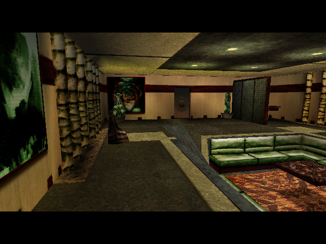

# 12. Evidence

← [Contents](README.md) · prev: [The port](11-the-port.md) · next: [Open questions](13-open-questions.md)

---

## In short

This chapter is about the difference between *a check passes* and *this is
true*. They are not the same thing, and a project like this one fails in the
gap between them.

There are **650 checks** (`python3 tools/verify.py --list`, counted
2026-11-02). About 250 run by default. The other ~400 sit behind `--slow`, and
most of those build the port and play part of the game. Every number quoted in
the documents is meant to be asserted by one of them, so the prose and the code
cannot drift apart unnoticed.

A passing check means only as much as the thing it compares against, and there
are **six grades** of that (`docs/PORTING.md` §B1). The strongest is
byte-identical to the shipped data. Next comes reproducing the original
engine's own output. Agreeing with a second implementation is weaker than it
looks: **two implementations of one reading agreeing is not evidence**. At the
bottom is a transcription that is internally consistent and says nothing about
the original at all. Each claim carries its grade in three places, so that a
green tick never implies more than was established.

The evidence has four sources:

* **the data**, which is fixed and can be tested exhaustively;
* **the original game itself**, which narrates what it does. Every script
  instruction announces its operand through a Windows call that sits before
  the check for whether the debug window exists. So the unmodified 1999
  executable, running under CrossOver, says what it is doing with no patch, shim
  or debugger;
* **the port measured against itself**, which is how every speed-up is proven:
  the same frame, byte for byte, before and after;
* **a person playing the port.** Most faults fixed in recent weeks were found
  that way, often with the original running beside it, and not by any check.

## In detail

### The six tiers

From `docs/PORTING.md` §B1, with its examples:

| tier | means | example that holds | what it does **not** license |
|---|---|---|---|
| **1 exact** | byte-identical to the shipped data | `.3DT` textures 2 534/2 534; ADPCM 777/777 sample-identical | anything about how the data is *used* |
| **2 corpus-constrained** | an invariant the shipped data could fail | `.CTL` 7/7 walks landing exactly on the file size; `.SCX` 220/220 | that the runtime reading it behaves correctly |
| **3 differential** | agrees with an independent implementation | `engine/` against `tools/sim`; `uitext.py` against `fnt.py` | anything both got wrong. They were often written from one reading |
| **4 behavioural** | reproduces the original's own output | the golden trace, 42/42 in order; the menu title 66 560/66 560, the selection outline 1 518/1 518, `Text_DrawRun` 6 132/6 132 | more than the capture actually contains |
| **5 data-constrained** | only the data it reads is checkable; the logic is not | `ACTOR_STATE` 0..17; the `.CTL` channel | that the machine *behaves* like the original |
| **6 read and explained** | a transcription with internal invariants only | the I2D display list's ordering; Astaroth's and the generic shooter's state graphs | anything at all about the original's behaviour |

Tier 3's warning, spelled out: it catches offsets, signedness and off-by-one
errors. It **cannot** catch a wrong reading applied consistently, because both
sides were written from that reading. Only tiers 1, 2 and 4 can (§B1).

Some things have **no reachable tier** and say so (§B6). The audio
attenuation and pan law belongs to DirectSound and is described nowhere in the
image. Every GPU backend (Vulkan, GLES, GL1, citro3d) is measured only against
the software reference, never against the original
(`engine/README.md` "What is left"). The remaster is "none, by design": it is
not a port, so it is held only to "off by default, byte-identical with it off,
a check per feature shown to fail".

### The rules that make a tier mean something

`docs/PORTING.md` §B2–§B3 set four requirements for every slice of the port:

* **The tier is declared in three places**: the source header, the check's
  docstring and the coverage row. Each is read by a different person. The rule
  comes from a specific failure. "The shoot AI has no data at all" was true of
  the dispatch, was written as if it were true of the subsystem, and survived in
  three documents.
* **An oracle is named, or the slice says why none is possible.**
* **At least one invariant the shipped data could fail**, or an explicit
  statement that there is none. I2D has exactly one (139 flag constants
  resolving), and it says so.
* **A falsification record.** Every check is *shown to fail* (§B4). Break it
  deliberately, record which mutation moves which number, and put that in the
  docstring.

`verify.py: porting standard` (`PORTING.md`, Enforcement) keeps the standard and
the coverage table from drifting apart. It checks that the coverage counts sum
to the row total, that the partly-ported table has the rows its headline
claims, and that every §B6 item is one the coverage table still calls
unfinished. It was green on 2026-11-02.

### Equivalence: the evidence for a speed-up

An optimisation has no oracle in the original. Its claim is narrower: **it
changed nothing**. So every step in `todo/optimization.md`,
`todo/cpu-vs-original.md` and `todo/ram-vs-original.md` ends in one of three
forms of equivalence:

* **frames byte-identical** before and after, usually on the software
  reference and a GPU backend, standing and walking;
* **an exhaustive comparison** where the input space is small enough, as with
  the music's ADPCM table, exact over all 93 323 264 channel states
  (`engine: adpcm table`);
* **an audit mode kept in the code**, such as `OMK_DIRTY_AUDIT=1` in the GLES
  backend, which compares a partial upload against a whole one.

A check usually holds the result afterwards: `engine: street memory` for the
memory cuts, `engine: raster cost` for the reference's speed, and
`engine: threaded bodies` for the crowd posed over several cores. This is
tier-3 reasoning about the port, not a claim about the original. It is the
right tool because the claim really is only "the same as before".

### The ways a falsification test lies

The show-it-fail rule has earned the most in practice. Its mechanics have also
failed in more ways than any other part of the apparatus. Each of these
happened, and each is recorded in `CLAUDE.md` §1 or `PORTING.md` §B4:

* **A mutation that did not apply.** A replacement whose anchor did not match
  left the code untouched, and the check "passed the mutation". Assert that the
  file changed.
* **A stale object file, in both directions.** If the rebuilt object and the old
  binary land in the same second, `make` relinks nothing and the mutation looks
  harmless (`engine: input`'s, which a forced relink moved from 18/19 to 28/57,
  §B4). In the other direction, macOS's make 3.81 compares whole seconds, so a
  mutation restored in the same second leaves the *mutated* object in place.
  After restoring a mutation, `touch` the file and rebuild.
* **A check that did not build what it measured.** Name every binary a check
  invokes in its `make` line.
* **A log line printed where a value is handed over** reports the intention,
  not the output. Print it from the value the consumer produced. Since
  2026-10-13 checks read **events** instead (`omk::event(...)`, `@evt` lines,
  `engine: events`), so rewording a `printf` cannot turn one red or green.
* **A scan that enumerates call sites** rots when a new renderer arrives.
  Match the invariant, not the callers.
* **A parse that reads nothing** can pass for free by comparing empty maps. A
  check that cannot read its input has to fail as a parse.
* **A comparison across builds taken for one within a build**, and **four
  agreeing dumps that were one stalled frame.** This is the 2026-09-29 wrong
  turn (`todo/optimization.md` §25). A GLES run blocks at frame 0 while the
  display sleeps, and a killed run still writes its `--dump`, so four
  agreeing dumps were read as a fix and committed (`446beb7`). The check for
  that "fix" could not be shown to fail, which gave it away, and the commit
  was reverted. The rule taken from it: **a dump is evidence only together
  with the frame count it came from** (read `N frames presented`).

### The traces: the original as an oracle

`tools/goldentrace.py` runs the game's own executable under CrossOver and
records what it announces (`docs/PRACTICE.md` §2 and §6). Nothing is patched.
The announcement is a `GetPrivateProfileStringA` call the engine makes to look
up its own operand names in `IAM\*.TAG`. That call sits before the debug
window's `if (hWnd)`, so it happens whether or not anybody is watching.

Five captures of play (`PRACTICE.md` §2) hold **1 315 events, all
attributable, with 64 scripts replayed**: the intro (58), a walk-in (76), the
walk out of the Impasse (286), a conversation from a save (55), and the
largest, 840, out to a restaurant lunch with nine conversations. The single
disagreement with the model is interleaving inside an anchor window, not a
different decision (`verify.py: trace agreement`). From a cold start the port
reproduces the intro capture **42 of 42 in order**. The 3DS build reproduces
it too, 42 of 42 in the Azahar emulator (`todo/handoff-3ds-port.md` §1). That
is the same tier-4 result on another CPU and another compiler.

A sixth capture, of a fight, produced **nothing** useful. The logger sees only
what a VM handler narrates. `fight.begin` announces nothing, and
`player.become` announces to a domain the logger filters out. The capture did
reach combat, so the silence comes from the mechanism, not from how the game
was played. That is why melee and shoot mode, both of which run in the port,
stay at tier 5. **Check whether a subsystem announces before asking anyone to
capture it.**

### The frame oracle, and what it licenses

The rig also grabs the engine's **own framebuffer**, and the recovery step
**refuses rather than degrades** (`PORTING.md` §B5). A 2× Retina grab is
accepted only if every 2×2 block is uniform.

* **2D is exact.** Every interface primitive ends in a blit, so there is no
  filtering to differ.
* **3D is exact about geometry and ordering, not about a pixel's low bits.**
  Filtering, dithering and the fog table belong to the driver, and Wine's is
  not a Voodoo's.
* **A frame is deterministic only in parts.** Across three captures of one
  screen, the title and the four labels' glyph pixels are identical while the
  frame as a whole differs by **52%**, because the background animates. A
  check may assert the text. It must not assert the scene.

The 3D rasterizer is **tier 4 for one camera** (`PORTING.md` §B6,
`verify.py: engine: silhouette`). The set seen through dialog 402's camera 4555
scores 0.73 / 0.83 on edge alignment against the two parked captures, against a
chance floor of 0.27 / 0.30. Removing the depth test drops it to 0.66 / 0.75,
so the ordering is tested and not assumed. That is a claim about one camera,
not about the renderer. Within hours of it, a player flying the viewer found the
missing near-plane clip, which changes 0 pixels through that camera and
12 710 one step into the room (`engine: near clip`).

*The port's software render of that set through camera 4555 (the command is in
[`images/README.md`](images/README.md)). The capture it is measured against is
[`traces/frames/dlg402-47.png`](../traces/frames/dlg402-47.png). The capture
also carries Telis, the props and a subtitle, and the metric is directed so
that their absence from the render is not counted against it.*

### Things that look like evidence and are not

From `PORTING.md` §B7 and `CLAUDE.md` §1:

* two implementations of one reading agreeing;
* asking the code that made a decision whether it made it correctly;
* a corpus test that cannot separate the rule from a simpler one. Of 9 103
  gated `.CTL` transitions, 120 are a real priority contest, and in **none** of
  them is the first match not also of maximal priority. The rule stands on the
  code, and the check says the corpus is silent;
* a count that is quietly short. A sweep reported 708 morph files where 777
  ship;
* generalising a negative beyond where it was measured;
* taking a name in the rename map as evidence (`Perso_SetInputEnabled` is a
  *block*);
* agreeing outputs whose provenance nobody checked;
* a number in the prose that nothing asserts.

### What the suite cannot see

A suite that compares this repository with itself cannot see a **wrong reading
applied consistently**. The dialogue staging stayed wrong through two "fixes"
while every check passed. One frame of the running game showed it in a second.

That is why "look at it" is a rule, and why the play report is the main source
of work. `todo/play-test.md` lists **41** items that are committed, have checks
behind them, and have not been played by a person. A commit message that says
**CONFIRMED IN PLAY** marks the ones that have. Nothing on the play-test list
counts as confirmed, however green its checks are.

### Running it

`--only` is the normal way to run the suite (`CLAUDE.md` §4): name the checks a
change could plausibly break and run those. **A red check is fixed alone**:
change the code, rerun that check, and rerun its neighbours only once it is
green.

The counts from `verify.py --list` on 2026-11-02:

* **651 entries**, of which **397** are marked `--slow` and **254** run by
  default;
* `engine: airlock walk` is registered **twice**, both times in the slow list,
  which leaves **650 distinct checks** (396 slow, 254 fast);
* **404** entries are `engine` checks, and **43** of those are in the default
  list. `CLAUDE.md` §4 now says plain `verify.py` "skips **most**" engine
  checks, which agrees.

**A full sweep means `--slow`**, now run in parallel (`--jobs 6`, since
2026-10-03). It is the reader's to start: it is advisable after five to ten
finished tasks, and the count is kept in `todo/sweep-log.md`. The recent
record, from that file's table:

| date | checks | failed | what they were |
|---|---|---|---|
| 2026-10-27 | 647 | **0** | the first sweep with no failure since 2026-09-09's 384 checks; even `shoot hit`, red on purpose until then, had been mended on 2026-10-11 |
| 2026-10-29 (M3) | 648 | 4 | two were not the code: a locally modified trace file, and Pillow absent on that machine |
| **2026-10-30** (M1, 1642 s) | **650** | **3** | see below |

The latest sweep's three reds, as recorded:

* `engine: lazy collision` was **intermittent**, and caused by that day's work.
  A timing printed in microseconds slipped through the check's timing filter.
  The filter was fixed, and it was green three runs in three.
* `INDEX.md fresh` was **left as committed**. `readable/src` is ignored by git,
  so each machine generates the index from its own copy, and the M1's and the
  M3's banners differ. Regenerating on one machine turns the other red.
* `engine: rain 3d` is **red alone and not re-pinned**. The Vulkan–GLES overlap
  of the rain's halos read 0.782 against a bound of 0.8. The halos are newer
  than every M1 sweep, so the M1's GPU is the likely cause. That is not
  proven.

On 2026-11-02 the counter stands at **8 tasks since that sweep**, inside the
five-to-ten band where one is advisable (`todo/sweep-log.md`).

## Where it lives

| | |
|---|---|
| the standard: tiers, the three places, show-it-fail, what a frame licenses | `docs/PORTING.md` Part B and its Enforcement section |
| the working practice and its traps | `CLAUDE.md` §1, long form `docs/PRACTICE.md` §1 |
| the checks | `tools/verify.py`; `--list` names every one and the document that quotes it |
| the rig | `tools/goldentrace.py`, `tools/frame.py` |
| the captures | `traces/`: the operand logs, the framebuffer grabs, and the saves they anchor to |
| equivalence for speed and memory | `todo/optimization.md`, `todo/cpu-vs-original.md`, `todo/ram-vs-original.md` |
| the 2026-09-29 wrong turn | `todo/optimization.md` §25 |
| the cadence and the sweep results | `todo/sweep-log.md`; what awaits a person, `todo/play-test.md` |

## What is not settled

* **The captures are CrossOver's rasterisation**, not a Voodoo's. Everything
  built on a 3D frame says which half of §B5 it relies on.
* **Tier 4 in 3D has been reached for exactly one camera in one set.** No
  pixel value in 3D reaches any tier.
* **Whole subsystems have no reachable oracle**, and say so: the actor channel,
  melee and shoot mode (tier 5 at best, because combat does not announce); the
  audio law; every GPU backend; the remaster by design.
* **The 2026-10-30 sweep left one red unexplained**: `engine: rain 3d` at
  0.782, attributed to the M1's GPU without proof. And `INDEX.md fresh` cannot
  be green on both machines until their `readable/src` copies are reconciled.
* **The console runs are outside `verify.py`.** The Vita, 3DS, Quest and
  classic-Mac results in chapter 11 are recorded runs, not repeatable checks.
  So is the big-endian replay of every tool call (`PORTING.md` §A9).
* **The drift audit's readings of the original are not re-verified.**
  `todo/drift-audit.md` says its own statements about what the original does
  are "the audit's reading of a doc, a code comment or the assembly", to be
  re-read before porting anything on them.
